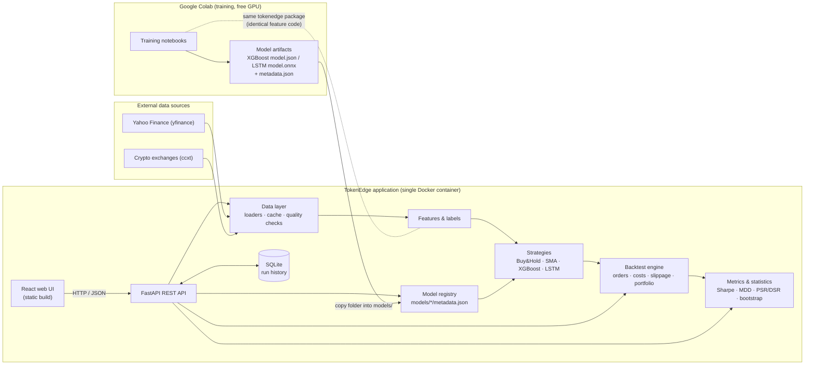
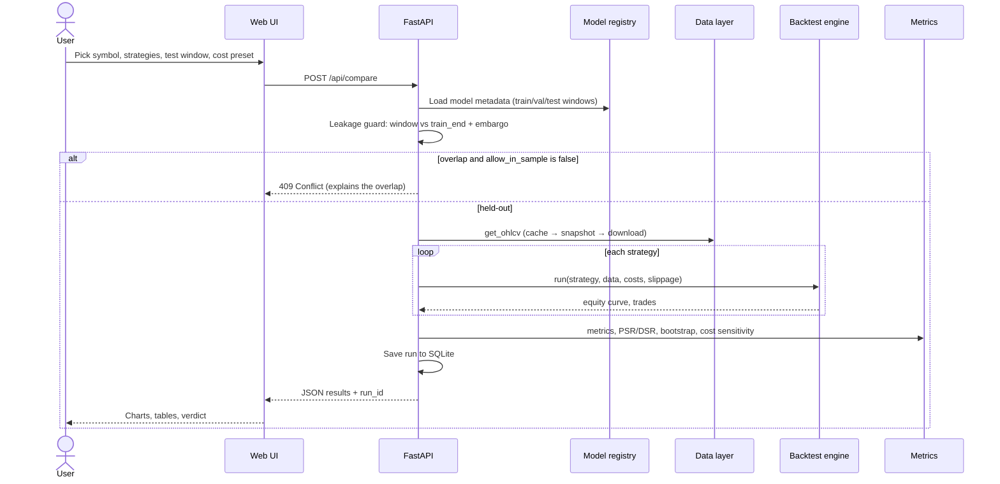

# TokenEdge — Product Requirements Document (PRD)

**AI-Powered Algorithmic Trading Research Platform**
Major Project — 4th Year

| Field | Value |
|---|---|
| Document version | 1.2 |
| Date | 25 October 2026 |
| Status | Approved; v0.2 implemented (see [Appendix C](#appendix-c--implementation-status)) |
| Repository | https://github.com/MR-SAIRAM-7/tokenEdge |
| Project team | _(add names / roll numbers)_ |
| Project guide | _(add name)_ |

> **Disclaimer.** TokenEdge is an educational research tool. It runs simulations on historical data only. It does not place real orders, connect to brokers, or give investment advice.

---

## Table of contents

1. [Executive summary](#1-executive-summary)
2. [Problem statement and motivation](#2-problem-statement-and-motivation)
3. [Goals and non-goals](#3-goals-and-non-goals)
4. [Users and personas](#4-users-and-personas)
5. [Scope](#5-scope)
6. [User stories](#6-user-stories)
7. [Functional requirements](#7-functional-requirements)
8. [Non-functional requirements](#8-non-functional-requirements)
9. [System architecture](#9-system-architecture)
10. [Data design](#10-data-design)
11. [Research methodology](#11-research-methodology)
12. [API specification](#12-api-specification)
13. [Web UI specification](#13-web-ui-specification)
14. [Repository structure](#14-repository-structure)
15. [Testing strategy](#15-testing-strategy)
16. [Deployment](#16-deployment)
17. [Timeline and milestones](#17-timeline-and-milestones)
18. [Risks and mitigations](#18-risks-and-mitigations)
19. [Success criteria and traceability](#19-success-criteria-and-traceability)
20. [Project deliverables](#20-project-deliverables)
21. [Future scope](#21-future-scope)
22. [Glossary](#22-glossary)
23. [References](#23-references)
24. [Appendix A — Metric formulas](#appendix-a--metric-formulas)
25. [Appendix B — Default configuration](#appendix-b--default-configuration)
26. [Appendix C — Implementation status](#appendix-c--implementation-status)

---

## 1. Executive summary

TokenEdge is a backtesting and signal-generation platform for comparing two families of trading strategies on historical equity and crypto data:

1. **A classical baseline**: a moving-average crossover strategy built from technical indicators.
2. **ML strategies**: an XGBoost classifier and an LSTM network that predict short-horizon price direction. Their predictions are turned into trading signals.

Every strategy runs through the same backtesting engine, which models transaction costs and slippage. Strategies are compared on a **held-out test period that no model or parameter search has ever seen**. The comparison uses risk-adjusted metrics: Sharpe ratio, Sortino ratio, maximum drawdown, Calmar ratio, the Probabilistic Sharpe Ratio and the Deflated Sharpe Ratio.

The methodology follows the backtesting and labeling guidance in López de Prado, *Advances in Financial Machine Learning* (2018), in particular:

- triple-barrier labeling
- purged and embargoed cross-validation
- the dangers of backtest overfitting
- statistics that correct for multiple testing

The system has three parts:

- **`tokenedge` Python library**: data, features, labels, engine, strategies, metrics and ML pipeline.
- **Google Colab notebooks**: train the models on a free GPU and export small artifacts (XGBoost `.json`, LSTM `.onnx`).
- **Web application**: a FastAPI backend and a React frontend for exploring data, running backtests, comparing strategies and inspecting models. It ships as one Docker container.

**No model is trained on the developer's laptop.** The web app only runs inference with the exported artifacts.

---

## 2. Problem statement and motivation

Retail and student algorithmic-trading projects often report results that look excellent and then fail out of sample. The usual causes are:

| Pitfall | What goes wrong |
|---|---|
| **Look-ahead bias** | Features, scalers or signals use information from the future, for example a scaler fitted on the full dataset or trading at the same bar's close that generated the signal. |
| **Train/test leakage** | Random K-fold shuffling of time series, or labels whose horizon crosses the train/test boundary. |
| **Ignoring frictions** | Commissions, spreads, slippage and taxes are left out. High-turnover strategies look profitable only because costs are zero. |
| **Backtest overfitting** | Many parameter combinations are tried and only the best one is reported, which inflates the Sharpe ratio. |
| **Wrong metric** | Prediction accuracy is reported instead of risk-adjusted P&L. A 55%-accurate model can still lose money. |

There is no simple, transparent, student-friendly tool that puts a classical strategy and an ML strategy side by side under the same realistic and leakage-free conditions. TokenEdge fills that gap. It produces an honest answer to one question: **after costs, on unseen data, does ML beat a simple rule?**

---

## 3. Goals and non-goals

### 3.1 Goals (mapped to the project objectives)

| ID | Goal | Project objective |
|---|---|---|
| G1 | Build a backtesting engine with realistic transaction-cost and slippage models. | Objective 1 |
| G2 | Implement a moving-average crossover baseline strategy. | Objective 2 |
| G3 | Train XGBoost and LSTM models for short-horizon price-movement prediction and use them as strategies. | Objective 3 |
| G4 | Compare risk-adjusted returns (Sharpe, max drawdown and others) on held-out data. | Objective 4 |
| G5 | Enforce strict train/test separation and prevent look-ahead bias, verified by automated tests. | Abstract |
| G6 | Provide a web UI that makes the research interactive and presentation-ready. | Project requirement |
| G7 | Make every result reproducible: same config, data snapshot and model give the same numbers. | Research quality |

### 3.2 Non-goals

- Live or paper trading, broker integration or order routing.
- Investment advice or recommendations to real users.
- High-frequency or tick-level simulation (order-book microstructure).
- Training models inside the web app or on the developer's laptop.
- Multi-user accounts, authentication or billing.
- Guaranteeing that the ML strategy beats the baseline. A negative result is a valid research outcome.

---

## 4. Users and personas

| Persona | Description | Primary needs |
|---|---|---|
| **Student researcher** (primary) | Final-year engineering student who builds and runs experiments. | Configure strategies and costs, run backtests quickly, compare results, export tables and charts for the report. |
| **Faculty evaluator** | Project guide or external examiner at reviews and the viva. | Understand the methodology at a glance, see the system run live, trust that results are leakage-free. |
| **Hobbyist quant / learner** | Anyone who clones the repo from GitHub. | Run locally with one command, learn backtesting pitfalls, extend with new strategies. |

---

## 5. Scope

### 5.1 MVP (must have)

- Data download and caching from **yfinance** (equities, ETFs, indices) and **ccxt** (crypto spot OHLCV).
- Bundled **offline snapshot datasets** so the app works without internet or when Yahoo rate-limits.
- Data-quality checks: gaps, duplicates, NaNs, zero volume, outlier returns.
- A library of technical indicators: SMA, EMA, RSI, MACD, Bollinger Bands, ATR, rolling volatility.
- Labeling: fixed-horizon and **triple-barrier**.
- An event-driven backtesting engine with:
  - next-bar-open execution
  - commission models
  - three slippage models
  - long/flat and long/short modes
  - position sizing
  - trade log and equity curve
- Four strategies: **Buy & Hold** (benchmark), **SMA crossover** (baseline), **XGBoost** and **LSTM**.
- Colab training notebooks for XGBoost and LSTM, with purged cross-validation and export to a model registry.
- Metrics: total return, CAGR, volatility, Sharpe, Sortino, max drawdown, Calmar, win rate, profit factor, turnover, exposure, PSR and DSR.
- A comparison report on the held-out test period, including a bootstrap confidence interval for the Sharpe difference.
- A **leakage guard** that warns about or blocks backtests whose window overlaps a model's training window.
- Web UI pages: Dashboard, Data Explorer, Backtest Lab, Compare, Models, Run History, Methodology.
- Run history stored in SQLite, with CSV and JSON export.
- Docker image, GitHub Actions CI and a cloud deployment.

### 5.2 Stretch (should or could have)

- Backtrader cross-validation adapter that runs the SMA strategy in Backtrader and checks the results match.
- Walk-forward (rolling re-training) evaluation, produced in Colab and replayed in the app.
- Probability-based bet sizing (AFML Ch. 10) instead of fixed all-in or all-out positions.
- Fractionally differentiated price features (AFML Ch. 5).
- Meta-labeling: the ML model filters signals from the SMA strategy.
- Feature importance views (gain or SHAP).
- An educational look-ahead bias experiment that runs a deliberately leaky model to show how bias inflates results.
- Multi-asset portfolio backtests.

### 5.3 Out of scope

Live trading, broker APIs, order-book or tick data, options and futures pricing, user authentication, mobile apps.

---

## 6. User stories

| ID | As a… | I want to… | So that… | Acceptance criteria |
|---|---|---|---|---|
| US-1 | Student | load daily OHLCV for `SPY` or hourly OHLCV for `BTC/USDT` | I can study the data before modelling. | Data loads in under 10 s on first fetch and under 1 s from cache. A candlestick chart and a quality report are shown. |
| US-2 | Student | run an SMA crossover backtest with custom windows and costs | I can establish a baseline. | Shows the equity curve, drawdown chart, trade markers on price, metrics table and trade log. |
| US-3 | Student | change commission or slippage and re-run | I can see how sensitive the strategy is to costs. | Metrics update. A cost-sensitivity chart shows Sharpe against cost in bps. |
| US-4 | Student | train XGBoost and LSTM in Colab and drop the artifacts into the app | I don't need a GPU or long CPU runs on my laptop. | Copying a model folder into `models/` makes it appear on the Models page without code changes. |
| US-5 | Student | compare SMA, XGBoost, LSTM and Buy & Hold on the held-out test period | I can answer the research question. | Side-by-side metrics, overlaid equity curves, PSR and DSR, a bootstrap CI for the Sharpe difference and an auto-generated verdict. |
| US-6 | Evaluator | see that the test period was never used for training | I can trust the results. | Each model card shows its train, validation and test windows. The UI shows a "Held-out ✓" badge, or a red "In-sample ⚠" warning when windows overlap. |
| US-7 | Student | export results as CSV or PNG | I can put them in my report and slides. | Export buttons on metrics tables, trade logs and charts. |
| US-8 | Student | reopen a previous run with the exact same results | my experiments are reproducible. | Run History stores the config, data hash, model ID and code version. Re-running gives identical metrics. |
| US-9 | Learner | read how look-ahead bias is prevented | I understand the methodology. | A Methodology page explains splits, purging, embargo, next-bar execution and the leakage tests, with diagrams. |

---

## 7. Functional requirements

Priority: **M** = Must, **S** = Should, **C** = Could.

### 7.1 Data ingestion (`tokenedge.data`)

| ID | Requirement | Priority |
|---|---|---|
| FR-D1 | Download OHLCV from yfinance for any Yahoo ticker (for example `SPY`, `AAPL`, `RELIANCE.NS`, `^NSEI`). Use split- and dividend-adjusted prices (`auto_adjust=True`). Intervals: `1d` (default), `1h`, `1wk`. | M |
| FR-D2 | Download OHLCV from any ccxt-supported exchange (default `binance`, configurable fallback such as `kraken` or `kucoin`). Paginate `fetch_ohlcv` for long histories and respect exchange rate limits. Intervals: `1h` (default), `4h`, `1d`. | M |
| FR-D3 | Normalize all data to one schema: `timestamp (UTC, tz-aware index), open, high, low, close, volume`, sorted ascending with unique timestamps. | M |
| FR-D4 | Cache downloads as Parquet in `data_cache/{source}/{symbol}_{interval}.parquet`. Refresh incrementally, fetching only bars newer than the last cached bar. | M |
| FR-D5 | Compute a SHA-256 **data hash** of the exact slice used in each run and store it with the run. | M |
| FR-D6 | Run quality checks and return a report: missing bars against the expected calendar, duplicates, NaNs, non-positive prices, zero-volume bars, \|return\| > 5σ outliers, OHLC consistency (`low ≤ open/close ≤ high`). | M |
| FR-D7 | Bundle offline snapshot datasets (CSV/Parquet in `data/snapshots/`) for the default universe, so the app works with `TOKENEDGE_OFFLINE=1`. | M |
| FR-D8 | Forward-fill only for display. Strategies never see forward-filled prices as tradable bars. Missing bars are skipped. | S |

**Default universe**

- Equities: `SPY`, `AAPL`, `MSFT`, `RELIANCE.NS`, `TCS.NS`, `NIFTYBEES.NS`
- Crypto: `BTC/USDT`, `ETH/USDT`, `SOL/USDT`

### 7.2 Feature engineering (`tokenedge.features`)

All features at bar *t* must use only data up to and including bar *t*. Rolling windows are right-aligned with no centering and no negative shifts.

| ID | Requirement | Priority |
|---|---|---|
| FR-F1 | Indicators: SMA, EMA, RSI(14), MACD(12,26,9), Bollinger Bands(20,2) and %B, ATR(14), rolling volatility, volume z-score. | M |
| FR-F2 | Feature set `v1` (see table below), versioned so that models record exactly which features they need. | M |
| FR-F3 | Rows with NaN features (indicator warm-up period) are dropped before training and produce no signal during backtests. | M |
| FR-F4 | One function `build_features(df, feature_set="v1")` is shared by the Colab notebooks and the web app, so training and inference features are identical. | M |
| FR-F5 | Fractionally differentiated close price (AFML Ch. 5) with a configurable *d*. | C |

**Feature set `v1`**

| Group | Features |
|---|---|
| Returns | log returns over 1, 2, 3, 5, 10, 20 bars |
| Trend | `close/SMA(n) − 1` for n ∈ {10, 20, 50}; `EMA(12)/EMA(26) − 1` |
| Momentum | RSI(14); MACD line, signal and histogram (each divided by close) |
| Volatility | rolling std of log returns over 10 and 20 bars; `ATR(14)/close`; Bollinger %B and bandwidth |
| Volume | volume z-score (20); `log(volume / SMA20(volume))` |
| Calendar | day-of-week (equities), hour-of-day (intraday crypto), one-hot or cyclical encoding |

### 7.3 Labeling (`tokenedge.labeling`)

| ID | Requirement | Priority |
|---|---|---|
| FR-L1 | **Fixed-horizon label**: `y_t = 1` if `close[t+h]/close[t] − 1 > τ`, otherwise 0. *h* defaults to 1 for daily data and 4 for hourly data. *τ* defaults to 0 and can be set to a cost-aware threshold. | M |
| FR-L2 | **Triple-barrier label** (AFML Ch. 3): upper barrier `+k_up·σ_t`, lower barrier `−k_dn·σ_t`, vertical barrier at `t+h`, where `σ_t` is the EWM volatility of returns. The label is set by the first barrier touched: 1 = upper, 0 = lower or vertical (binary mode). | M |
| FR-L3 | Each label records its **event end time** `t1` (the bar at which it is resolved). Purging uses `t1`. | M |
| FR-L4 | Report class balance per split. Training supports `scale_pos_weight` or class weights. | S |
| FR-L5 | Sample weights by label uniqueness (AFML Ch. 4). | C |

### 7.4 Strategies (`tokenedge.strategies`)

Common interface:

```python
class Strategy(Protocol):
    name: str
    params: dict
    def generate_signals(self, data: pd.DataFrame) -> pd.Series:
        """Target position per bar in {-1, 0, +1}, computed causally.
        The signal at bar t may use data up to and including bar t.
        The engine executes it at the OPEN of bar t+1."""
```

| ID | Strategy | Requirement | Priority |
|---|---|---|---|
| FR-S1 | **Buy & Hold** | Long from the first bar to the last bar of the window. Used as a benchmark. | M |
| FR-S2 | **SMA crossover** | Long when `SMA(fast) > SMA(slow)`, otherwise flat (or short if shorting is enabled). Parameters: `fast` (default 20), `slow` (default 50), and optionally `ma_type` (SMA or EMA). | M |
| FR-S3 | **SMA parameter tuning** | Grid search over `fast` ∈ {5, 10, 20, 30, 50} × `slow` ∈ {50, 100, 150, 200} on **train/validation only**, selected by validation Sharpe. The chosen parameters are frozen before the test period. The number of trials is recorded for the DSR. | M |
| FR-S4 | **XGBoost strategy** | Loads a registered XGBoost model and computes `p_t = P(up)` from features at *t*. Long if `p_t > θ_long` (default chosen on validation, for example 0.55). Short if `p_t < θ_short` when shorting is enabled. Otherwise flat. | M |
| FR-S5 | **LSTM strategy** | Same as FR-S4, but the model input is the last `seq_len` bars of scaled features. The scaler parameters come from training metadata. Inference uses ONNX Runtime. | M |
| FR-S6 | **Minimum holding period** | Optional `min_hold` bars to reduce churn for all strategies. | S |
| FR-S7 | **Plugin registry** | Strategies register themselves with a parameter schema (Pydantic). The UI renders parameter forms from that schema automatically. | S |
| FR-S8 | **Meta-labeling strategy** | SMA crossover provides the side and an ML model decides whether to take each trade. | C |

### 7.5 Backtesting engine (`tokenedge.engine`)

| ID | Requirement | Priority |
|---|---|---|
| FR-E1 | **Event-driven bar loop.** At each bar the engine (1) fills pending orders at this bar's **open**, (2) marks the portfolio to market at the **close**, (3) reads the strategy's target position for this bar, and (4) creates orders to execute at the next bar's open. | M |
| FR-E2 | **No same-bar execution.** A signal computed from bar *t* data can never be filled at a price from bar *t*. | M |
| FR-E3 | **Position sizing.** Target weight × equity × `max_leverage` (default 1.0). Integer share quantities for equities (configurable) and fractional quantities for crypto. | M |
| FR-E4 | **Commission model**: `fee = max(min_fee, |qty|·price·commission_bps/10⁴) + fixed_fee`, with separate buy and sell rates (for example to model STT). | M |
| FR-E5 | **Slippage models.** The fill price is moved against the trader by *s*. **(a) Fixed:** `s = slippage_bps/10⁴`. **(b) Range-based:** `s = k·(H−L)/C` of the previous bar. **(c) Square-root impact:** `s = half_spread + η·σ_daily·√(Q/ADV₂₀)`. | M |
| FR-E6 | **Cost presets**, all editable: **Zero-cost** (for ablation); **US equity** (0 bps commission, 2 bps slippage); **Indian equity delivery (NSE)** (≈11–12 bps per side for STT, exchange charges, GST and stamp duty, plus 3 bps slippage); **Crypto spot taker** (10 bps per side, 3 bps slippage). | M |
| FR-E7 | Long/flat mode is the default. Long/short mode is optional, with a configurable annual borrow cost on short positions. | M |
| FR-E8 | **Outputs**: equity curve, cash, position, gross and net returns per bar, drawdown series, and a trade log (entry/exit time and price, side, quantity, gross P&L, costs, net P&L, return, bars held). | M |
| FR-E9 | Positions open at the end of the window are closed at the last bar's close, with costs, so that metrics are comparable. | M |
| FR-E10 | Deterministic: identical inputs always give identical outputs. | M |
| FR-E11 | **Backtrader cross-check**: run the same SMA strategy and cost settings in Backtrader. Total return must match within 0.5 percentage points and the trade count must match exactly. | S |
| FR-E12 | **Interest on idle cash** at a configurable annual rate, defaulting to the risk-free rate used for the Sharpe ratio, so a strategy that stays flat has zero excess return instead of being penalised by the risk-free rate. | S |

### 7.6 ML training pipeline and model registry (`tokenedge.ml`, `notebooks/`)

| ID | Requirement | Priority |
|---|---|---|
| FR-M1 | **Colab notebooks** `01_train_xgboost.ipynb` and `02_train_lstm.ipynb`. They clone the repo, `pip install -e .`, load data through the same data layer, build features and labels, train, evaluate and export a zipped model folder. | M |
| FR-M2 | **Chronological splits** into train / validation / test with **purging** (drop training samples whose label end time `t1` falls in the next split) and an **embargo** (skip *e* bars after each boundary). | M |
| FR-M3 | **Purged K-fold CV** (AFML Ch. 7) on the training set for XGBoost hyperparameter search. Default 5 folds with embargo. Search space: `max_depth`, `learning_rate`, `n_estimators`, `subsample`, `colsample_bytree`, `min_child_weight`. Random or Optuna search with a fixed trial budget, and the trial count is recorded. | M |
| FR-M4 | **LSTM**: 2-layer LSTM (hidden 64, dropout 0.2) → linear → sigmoid. Sequence length 60 for daily data and 48 for hourly data. Trained with BCE loss, Adam (lr 1e-3), early stopping on validation loss (patience 10) and a fixed seed. The feature scaler is fitted **on the training set only**. | M |
| FR-M5 | **Decision threshold** θ chosen on the validation set by maximising validation Sharpe after costs, not accuracy. | M |
| FR-M6 | **Export**: XGBoost → `model.json` (native format). LSTM → `model.onnx` (opset ≥ 17) plus `scaler.json`. Every model also gets a `metadata.json` (schema in §10.3). | M |
| FR-M7 | **Registry**: the app scans `models/*/metadata.json` at startup and on demand. Adding or removing a folder adds or removes a model, with no code changes. | M |
| FR-M8 | Ship at least one pre-trained XGBoost and one LSTM model per default asset class (for example SPY daily and BTC/USDT hourly), committed to the repo if they are under 5 MB each. | M |
| FR-M9 | Validation metrics stored with each model: accuracy, precision, recall, F1, ROC-AUC, log-loss, confusion matrix, and feature importance (XGBoost gain). | M |
| FR-M10 | Optional `scripts/train.py` CLI with the same logic as the notebooks, for anyone with a GPU. | S |
| FR-M11 | Walk-forward predictions: Colab produces out-of-sample predictions with rolling re-training and exports them as `predictions.parquet`, which the app can replay as a strategy. | C |

### 7.7 Evaluation, metrics and statistics (`tokenedge.metrics`)

| ID | Requirement | Priority |
|---|---|---|
| FR-X1 | **Return metrics**: total return, CAGR, annualized volatility, best and worst period. | M |
| FR-X2 | **Risk-adjusted metrics**: Sharpe (with a configurable risk-free rate), Sortino, Calmar, max drawdown, max drawdown duration. | M |
| FR-X3 | **Trade metrics**: number of trades, win rate, average win and loss, profit factor, average bars held, turnover, exposure (% of time in the market), total costs paid. | M |
| FR-X4 | **Annualization**: 252 periods per year for daily equities, 365 for daily crypto, 365×24 for hourly crypto, 252×6.5 for hourly equities. Configurable. | M |
| FR-X5 | **Probabilistic Sharpe Ratio (PSR)**: the probability that the true Sharpe is above a benchmark (default 0), adjusted for skewness and kurtosis. | M |
| FR-X6 | **Deflated Sharpe Ratio (DSR)**: PSR with a benchmark adjusted for the number of trials *N* recorded during tuning. | M |
| FR-X7 | **Bootstrap test**: stationary block bootstrap (default 5,000 resamples) of the Sharpe difference between two strategies, giving a 95% CI and a one-sided p-value. | M |
| FR-X8 | **Cost sensitivity**: re-run each strategy at 0, 5, 10, 20, 50 bps per side and report Sharpe and CAGR for each. | M |
| FR-X9 | **Classification diagnostics** on the test period (accuracy, AUC), reported alongside the P&L metrics to show that accuracy and profitability are not the same thing. | S |
| FR-X10 | **Verdict generator**: a plain-language summary, for example "XGBoost had a higher Sharpe than SMA (0.84 vs 0.61), but the 95% CI of the difference [−0.21, 0.67] includes 0, so the improvement is not statistically significant." | S |

### 7.8 Look-ahead bias and leakage prevention (`tokenedge.validation`)

| ID | Requirement | Priority |
|---|---|---|
| FR-V1 | **Causal features**: verified by a future-perturbation test. Features at bars ≤ *t* must be bit-identical when computed on `data[:t]` and on `data[:t+k]` with random future data appended. | M |
| FR-V2 | **Causal signals**: the same perturbation test applied to every strategy's `generate_signals`. | M |
| FR-V3 | **Next-bar execution**: an engine test asserts that every fill timestamp is strictly later than its signal timestamp. | M |
| FR-V4 | **Scaler fit scope**: the scaler is fitted only on training rows. The fit window is stored in metadata and checked at load time. | M |
| FR-V5 | **Window guard**: when a backtest uses an ML model, the API compares the requested start with the model's held-out start, which is the start of its test window (after validation plus embargo). Validation data counts as in-sample because it was used for early stopping and threshold selection. Overlap returns HTTP 409, unless the user explicitly sets `allow_in_sample=true`, in which case the result carries an **In-sample ⚠** flag. | M |
| FR-V6 | **Test-set lock**: the default comparison window is the model's registered test window. Every evaluation on the test window is logged, with a counter shown in the UI. | S |
| FR-V7 | **Documented limitations**: survivorship bias (yfinance only lists tickers that exist today) and adjusted-price caveats, shown on the Methodology page. | M |

### 7.9 Web application

See §13 for the page specification. Summary:

| ID | Requirement | Priority |
|---|---|---|
| FR-W1 | Dashboard with project summary, quick-run card and recent runs. | M |
| FR-W2 | Data Explorer: symbol search, source and interval selection, candlestick chart with indicator overlays, quality report. | M |
| FR-W3 | Backtest Lab: strategy picker, auto-generated parameter form, cost and slippage panel, date window; results with equity curve, drawdown, trade markers, metrics and trade log. | M |
| FR-W4 | Compare: choose strategies and window; overlaid equity curves, metrics table, PSR/DSR, bootstrap CI, cost-sensitivity chart, verdict. | M |
| FR-W5 | Models: model cards with metadata, split timeline, validation metrics, confusion matrix and feature importance. | M |
| FR-W6 | Run History: list, filter, reopen, delete, export runs. | M |
| FR-W7 | Methodology: explanation of the leakage-prevention design with diagrams. | M |
| FR-W8 | Export: CSV (metrics, trades, equity) and PNG (charts). | M |
| FR-W9 | Dark and light themes; responsive down to tablet width. | S |

### 7.10 Run history and reproducibility

| ID | Requirement | Priority |
|---|---|---|
| FR-R1 | Every backtest or comparison is saved to SQLite with: run ID, timestamp, kind, full config JSON, data hash, model ID, git commit SHA, library versions, metrics and result payload. | M |
| FR-R2 | Re-running a saved config on the same data snapshot reproduces identical metrics. | M |
| FR-R3 | Runs can be exported as a single JSON bundle and re-imported. | C |

---

## 8. Non-functional requirements

| ID | Category | Requirement |
|---|---|---|
| NFR-1 | Performance | A single backtest on 10 years of daily data (~2,500 bars) finishes in under 1 s. On 3 years of hourly crypto (~26,000 bars) it finishes in under 3 s. |
| NFR-2 | Performance | A full comparison (4 strategies + 5,000-sample bootstrap + cost sensitivity) finishes in under 10 s on a 2-vCPU server. |
| NFR-3 | Performance | Cached data loads in under 1 s. UI pages become interactive in under 2 s on broadband. |
| NFR-4 | Footprint | The runtime Docker image uses **no PyTorch** (ONNX Runtime only). Image under 1.2 GB, idle memory under 500 MB. |
| NFR-5 | Reproducibility | Fixed random seeds. Data hashes, model IDs and code versions stored with every run. Dependencies pinned (`requirements.lock` / `package-lock.json`). |
| NFR-6 | Correctness | ≥ 85% line coverage on `tokenedge/engine`, `metrics`, `labeling` and `validation`. All leakage tests pass in CI. |
| NFR-7 | Usability | Every metric has a tooltip that explains it. Errors are shown as readable messages, never stack traces. |
| NFR-8 | Portability | Runs on Windows, macOS and Linux with Python ≥ 3.11 and Node ≥ 20. Runs anywhere with `docker run`. |
| NFR-9 | Security | No secrets required (public data endpoints). All inputs validated with Pydantic. CORS restricted to configured origins. Request size limits. No arbitrary code execution from user input. |
| NFR-10 | Maintainability | Type hints throughout, `ruff` lint and format, `mypy` on the core package, docstrings on public APIs, modular strategy plugins. |
| NFR-11 | Availability | Offline mode with bundled snapshots, so the app never depends on Yahoo or exchange uptime. |
| NFR-12 | Compliance | A visible disclaimer in the UI footer and README: educational use only, not financial advice. |

---

## 9. System architecture

### 9.1 High-level architecture



### 9.2 Comparison request flow



### 9.3 Technology stack

| Layer | Choice | Why |
|---|---|---|
| Language | Python 3.11+ | Ecosystem for data and ML. Colab ships a compatible version. |
| Data | `pandas`, `numpy`, `pyarrow` | Standard tabular stack. Parquet for fast, typed caching. |
| Market data | `yfinance`, `ccxt` | Given in the project brief. Free, no API keys needed. |
| Backtesting | **Own event-driven engine** (primary) + **Backtrader** (cross-check) | The objective is to *build* an engine with realistic costs, so we write the core ourselves for full control and transparency. Backtrader independently checks correctness. Zipline-reloaded was rejected because its data-bundle setup is heavy for crypto and custom intervals. |
| ML (training, Colab) | `xgboost`, `torch`, `scikit-learn`, `optuna` | Given in the brief. GPU in Colab. |
| ML (inference, app) | `xgboost` (CPU), `onnxruntime` | ONNX Runtime keeps the server small: no PyTorch at runtime. |
| Statistics | `scipy`, `numpy` | PSR/DSR, bootstrap. |
| API | **FastAPI**, `pydantic` v2, `uvicorn` | Fast, typed, auto-generated OpenAPI docs at `/docs`. |
| Storage | **SQLite** via SQLAlchemy 2.x | Zero-configuration, file-based, enough for single-user research. |
| Frontend | **React 19 + TypeScript + Vite** | Modern, fast builds, type safety. |
| UI styling | Tailwind CSS + shadcn/ui-style components | Clean professional look with little custom CSS. |
| Charts | **TradingView Lightweight Charts** (price, trades); **Recharts** (equity, drawdown, bars) | Purpose-built financial charts plus flexible general charts. |
| Data fetching | TanStack Query | Caching, loading and error states. |
| Testing | `pytest`, `hypothesis`, `pytest-cov`; Vitest; Playwright (stretch) | Unit, property-based and end-to-end testing. |
| Quality | `ruff`, `mypy`, ESLint, Prettier, pre-commit | Consistent code. |
| Packaging and deployment | Docker (multi-stage), GitHub Actions, Render (Hugging Face Spaces as an alternative) | Free hosting, one container. |

### 9.4 Key design decisions

1. **Vectorized signals, event-driven execution.** Strategies compute signals for all bars at once using only causal operations, which is fast. The engine then simulates fills bar by bar, which is realistic. Causality is enforced by tests (FR-V1/V2), not by slow O(n²) re-computation.
2. **Train in Colab, infer in the app.** Training and the app share one Python package (`tokenedge`), so feature code cannot drift between training and inference. Artifacts are small and portable.
3. **The model carries its own provenance.** `metadata.json` records splits, features, label config, scaler, threshold and data hash. The app uses it to enforce the leakage guard.
4. **Single container deployment.** FastAPI serves the built React app as static files, so there is one service to deploy and no CORS problems in production.
5. **Synchronous API.** Backtests finish in seconds, so no job queue (Celery or Redis) is needed. Reconsider only if walk-forward replays become slow.

---

## 10. Data design

### 10.1 File layout

```
data_cache/                 # git-ignored, created at runtime
  yfinance/SPY_1d.parquet
  ccxt_binance/BTC-USDT_1h.parquet
data/snapshots/             # committed, offline datasets
  SPY_1d.parquet
  BTC-USDT_1h.parquet
models/                     # committed (small) model artifacts
  xgb_spy_1d_tb_v1/
    metadata.json
    model.json
  lstm_btcusdt_1h_fh_v1/
    metadata.json
    model.onnx
    scaler.json
tokenedge.db                # git-ignored, SQLite run history
```

### 10.2 OHLCV schema

| Column | Type | Notes |
|---|---|---|
| `timestamp` (index) | `datetime64[ns, UTC]` | Bar open time, unique, ascending |
| `open`, `high`, `low`, `close` | `float64` | Adjusted for equities |
| `volume` | `float64` | Shares or base-currency units |

### 10.3 Model `metadata.json` schema

```json
{
  "model_id": "xgb_spy_1d_tb_v1",
  "model_type": "xgboost",
  "artifact": "model.json",
  "symbol": "SPY",
  "source": "yfinance",
  "interval": "1d",
  "feature_set": "v1",
  "features": ["ret_1", "ret_2", "...", "vol_z_20"],
  "label": {
    "method": "triple_barrier",
    "horizon": 5,
    "pt_sl": [1.5, 1.0],
    "vol_span": 20
  },
  "splits": {
    "train": ["2012-01-03", "2020-12-31"],
    "val":   ["2021-01-04", "2022-12-30"],
    "test":  ["2023-01-03", "2026-09-30"]
  },
  "purge_bars": 5,
  "embargo_bars": 5,
  "seq_len": null,
  "scaler": null,
  "threshold": { "long": 0.55, "short": 0.45 },
  "hyperparameters": { "max_depth": 4, "learning_rate": 0.05, "n_estimators": 400 },
  "cv": { "method": "purged_kfold", "folds": 5, "trials": 60 },
  "metrics": {
    "val": { "accuracy": 0.54, "roc_auc": 0.56, "f1": 0.58, "log_loss": 0.69, "sharpe_after_costs": 0.71 }
  },
  "feature_importance": { "ret_5": 0.11, "rsi_14": 0.09 },
  "data_hash": "sha256:…",
  "seed": 42,
  "created_at": "2026-11-20T10:15:00Z",
  "library_versions": { "xgboost": "x.y.z", "pandas": "x.y.z" },
  "tokenedge_version": "0.1.0"
}
```

The metric values above are placeholders that illustrate the schema. They are not expected results.

### 10.4 SQLite schema

```sql
CREATE TABLE runs (
  id            TEXT PRIMARY KEY,          -- UUID
  created_at    TEXT NOT NULL,             -- ISO-8601 UTC
  kind          TEXT NOT NULL,             -- 'backtest' | 'compare'
  name          TEXT,                      -- optional user label
  symbol        TEXT NOT NULL,
  source        TEXT NOT NULL,
  interval      TEXT NOT NULL,
  start_date    TEXT NOT NULL,
  end_date      TEXT NOT NULL,
  config_json   TEXT NOT NULL,             -- full request config
  model_ids     TEXT,                      -- JSON array
  data_hash     TEXT NOT NULL,
  git_sha       TEXT,
  in_sample     INTEGER NOT NULL DEFAULT 0,
  metrics_json  TEXT NOT NULL,             -- summary metrics per strategy
  result_blob   BLOB NOT NULL              -- gzip JSON: equity, drawdown, trades
);
CREATE INDEX idx_runs_created ON runs(created_at DESC);
CREATE INDEX idx_runs_symbol  ON runs(symbol);

CREATE TABLE test_evaluations (            -- test-set lock audit (FR-V6)
  id         INTEGER PRIMARY KEY AUTOINCREMENT,
  model_id   TEXT NOT NULL,
  run_id     TEXT NOT NULL REFERENCES runs(id) ON DELETE CASCADE,
  created_at TEXT NOT NULL
);
```

---

## 11. Research methodology

### 11.1 Data splits

```
|<---------------- TRAIN ---------------->|P|E|<--- VALIDATION --->|P|E|<------- TEST (locked) ------->|
 2012-01                            2020-12      2021-01     2022-12      2023-01                latest
 P = purge (drop samples whose label horizon crosses the boundary)    E = embargo (skip e bars)
```

| Asset class | Interval | Train | Validation | Test (held-out) |
|---|---|---|---|---|
| Equities (SPY, AAPL, RELIANCE.NS …) | 1d | 2012-01-01 → 2020-12-31 | 2021-01-01 → 2022-12-31 | 2023-01-01 → latest |
| Crypto (BTC/USDT, ETH/USDT …) | 1h | 2019-01-01 → 2023-06-30 | 2023-07-01 → 2024-06-30 | 2024-07-01 → latest |

The test windows contain different market regimes: the 2023–24 equity recovery and 2024–26 crypto cycles. The training periods include the 2020 crash and the 2022 bear market.

### 11.2 Protocol (what is allowed to touch which data)

| Activity | Train | Validation | Test |
|---|:---:|:---:|:---:|
| Fit scaler / feature normalization | ✓ | ✗ | ✗ |
| XGBoost hyperparameter search (purged K-fold) | ✓ | ✗ | ✗ |
| Early stopping (XGBoost, LSTM) | ✗ | ✓ | ✗ |
| Choose decision threshold θ | ✗ | ✓ | ✗ |
| Choose SMA windows (grid search) | ✓ | ✓ | ✗ |
| Choose cost preset | — | — | fixed before the test run |
| **Final comparison** | ✗ | ✗ | ✓ (once, logged) |

### 11.3 Experiments

| ID | Experiment | Question | Output |
|---|---|---|---|
| E1 | **Main comparison**: Buy & Hold vs SMA vs XGBoost vs LSTM on the test window for SPY, AAPL, RELIANCE.NS, BTC/USDT, ETH/USDT | Does ML beat the classical baseline after costs? | Metrics table, equity curves, PSR/DSR, bootstrap CI |
| E2 | **Cost sensitivity** at 0, 5, 10, 20, 50 bps per side | At what cost level does each strategy's edge disappear? | Sharpe vs cost chart, break-even cost |
| E3 | **Labeling ablation**: fixed-horizon vs triple-barrier | Does triple-barrier labeling improve trading performance? | Paired metrics |
| E4 | **Look-ahead bias experiment**: same XGBoost with (a) random K-fold and (b) a scaler fitted on all data | How much does leakage inflate backtest results? | Leaky vs clean Sharpe (educational) |
| E5 | **Overfitting check**: DSR using the real trial counts | Does the best strategy survive multiple-testing correction? | DSR values |
| E6 | **Accuracy vs profitability**: classification metrics against Sharpe | Does a higher AUC mean a higher Sharpe? | Scatter/table |
| E7 | **Extensions**: each model as a confirmation filter on the tuned SMA (FR-S8), and with probability bet sizing (AFML Ch. 10) | Do the models add value as a filter or through position sizing rather than as stand-alone signals? | Paired metrics, Sharpe at rf = 0 |

### 11.4 Reporting standard

Every reported result states:

- the asset and interval
- the exact test window
- the cost preset
- the model IDs
- the data hash
- the number of trials behind any tuned parameter

Results are reported as they come out, including negative ones.

---

## 12. API specification

Base path: `/api`. The OpenAPI/Swagger docs are generated automatically at `/docs`.

| Method | Path | Description |
|---|---|---|
| GET | `/api/health` | Liveness check. Returns version, offline flag and number of models. |
| GET | `/api/symbols` | Default universe and the available snapshots. |
| GET | `/api/data/ohlcv` | OHLCV bars. Query: `symbol, source, interval, start, end`. |
| GET | `/api/data/quality` | Data-quality report for a symbol and window. |
| GET | `/api/indicators` | Indicator series for charts. Query: `symbol, …, indicators=sma:20,rsi:14`. |
| GET | `/api/strategies` | Registered strategies with JSON-Schema parameter definitions. |
| GET | `/api/cost-presets` | Cost and slippage presets. |
| GET | `/api/models` | Registered models (summary). |
| GET | `/api/models/{model_id}` | Full model metadata. |
| POST | `/api/backtest` | Run one strategy. Returns metrics, series and trades. |
| POST | `/api/compare` | Run several strategies on the same window, plus statistics. |
| POST | `/api/sensitivity` | Cost-sensitivity sweep for given strategies. |
| GET | `/api/runs` | List runs (paginated, filterable by symbol and kind). |
| GET | `/api/runs/{run_id}` | Full stored run. |
| DELETE | `/api/runs/{run_id}` | Delete a run. |
| GET | `/api/runs/{run_id}/export?format=csv\|json` | Download run data. |
| GET | `/api/runs/bundle?ids=` | Every run (or the given IDs) as one JSON bundle (FR-R3). |
| POST | `/api/runs/import` | Import a bundle or a single exported run; runs that already exist are skipped. |
| GET | `/api/findings` | Latest comparison per market, condensed for the findings scoreboard. |
| GET | `/api/markets/overview` | Last price, changes, volatility and a sparkline for each bundled market. |
| GET | `/api/study/status` · POST `/api/study/run` | Status of, and trigger for, the research study (a fixed set of comparisons and backtests). |

### 12.1 Example: `POST /api/backtest`

Request:

```json
{
  "symbol": "SPY",
  "source": "yfinance",
  "interval": "1d",
  "start": "2023-01-01",
  "end": "2026-09-30",
  "initial_capital": 100000,
  "strategy": { "name": "sma_crossover", "params": { "fast": 20, "slow": 50, "ma_type": "sma" } },
  "execution": {
    "mode": "long_flat",
    "max_leverage": 1.0,
    "fractional": false,
    "commission": { "buy_bps": 0, "sell_bps": 0, "fixed_fee": 0, "min_fee": 0 },
    "slippage": { "model": "fixed", "bps": 2 }
  },
  "risk_free_rate": 0.04,
  "allow_in_sample": false
}
```

Response (abridged):

```json
{
  "run_id": "6f0c…",
  "in_sample": false,
  "warnings": [],
  "metrics": {
    "total_return": 0.312, "cagr": 0.078, "volatility": 0.121,
    "sharpe": 0.64, "sortino": 0.91, "max_drawdown": -0.104,
    "calmar": 0.75, "psr": 0.88, "trades": 14, "win_rate": 0.57,
    "profit_factor": 1.9, "exposure": 0.71, "turnover": 6.2, "total_costs": 412.3
  },
  "series": {
    "timestamp": ["2023-01-03T00:00:00Z", "…"],
    "equity": [100000, "…"],
    "drawdown": [0, "…"],
    "position": [0, "…"],
    "benchmark_equity": [100000, "…"]
  },
  "trades": [
    { "entry_time": "…", "exit_time": "…", "side": "long", "qty": 210,
      "entry_price": 452.1, "exit_price": 471.8, "gross_pnl": 4137, "costs": 38.9,
      "net_pnl": 4098.1, "return": 0.043, "bars_held": 27 }
  ]
}
```

The numbers are illustrative only.

### 12.2 Example: `POST /api/compare`

```json
{
  "symbol": "SPY", "source": "yfinance", "interval": "1d",
  "window": "model_test",
  "strategies": [
    { "name": "buy_hold" },
    { "name": "sma_crossover", "params": { "fast": 20, "slow": 100 } },
    { "name": "xgboost", "params": { "model_id": "xgb_spy_1d_tb_v1" } },
    { "name": "lstm",    "params": { "model_id": "lstm_spy_1d_fh_v1" } }
  ],
  "execution": { "preset": "us_equity" },
  "statistics": { "bootstrap_samples": 5000, "block_size": "auto", "baseline": "sma_crossover" }
}
```

The response contains per-strategy `metrics` and `series`, a pairwise `sharpe_diff` (estimate, 95% CI, p-value), `psr` and `dsr` per strategy, and a `verdict` string.

### 12.3 Error model

```json
{ "error": { "code": "IN_SAMPLE_WINDOW", "message": "Requested window starts 2020-06-01, before model train_end + embargo (2021-01-11).", "details": { "model_id": "xgb_spy_1d_tb_v1" } } }
```

| Code | HTTP status |
|---|---|
| `VALIDATION_ERROR` | 422 |
| `IN_SAMPLE_WINDOW` | 409 |
| `DATA_UNAVAILABLE` | 404 or 503 |
| `MODEL_NOT_FOUND` | 404 |
| `INSUFFICIENT_DATA` | 422 |

---

## 13. Web UI specification

**Layout**: a left sidebar for navigation, a top bar with the global symbol/interval picker, an "Offline" badge and a theme toggle, and a footer disclaimer. The visual style is a dark-first "trading terminal" look with a light mode option.

| Page | Contents |
|---|---|
| **1. Dashboard** | Hero summary of the research question. KPI tiles from the latest comparison run (best Sharpe, best max drawdown). A quick-run card (symbol + "Run default comparison"). Recent runs list. |
| **2. Data Explorer** | Symbol, source and interval pickers. Date range. Candlestick chart (Lightweight Charts) with toggleable SMA/EMA/Bollinger overlays. RSI and MACD sub-panes. Volume histogram. Data-quality card (gaps, NaNs, outliers). Download-CSV button. |
| **3. Backtest Lab** | **Left panel**: strategy selector; dynamic parameter form generated from the strategy schema; execution panel (mode, sizing, cost preset dropdown, editable commission and slippage fields, slippage model picker); date window with presets "Train / Validation / Test"; Run button. **Results**: KPI tiles (CAGR, Sharpe, Sortino, max drawdown, trades, exposure); equity curve against Buy & Hold; underwater (drawdown) chart; price chart with buy/sell markers; monthly returns heatmap; trade log table (sortable, CSV export); "Held-out ✓ / In-sample ⚠" badge. |
| **4. Compare** | Strategy multi-select (defaults to all four). Window defaults to the model test window. Overlaid equity curves. Metrics comparison table with best values highlighted. PSR/DSR bars. Bootstrap distribution of the Sharpe difference with the CI marked. Cost-sensitivity line chart (Sharpe vs bps). Plain-language verdict card. "Export report" (CSV + PNGs). |
| **5. Models** | Model cards (type, asset, interval, created date). Detail view: split timeline (train/val/test bars with purge and embargo), label config, hyperparameters, validation metrics, confusion matrix, ROC curve (if stored), feature importance bar chart, trial count. "Use in Backtest" button. |
| **6. Run History** | Table: name, date, symbol, kind, strategies, Sharpe, in-sample flag. Filter and search. Open (re-renders the stored results), rename, delete, export. |
| **7. Methodology** | Illustrated explanation of each leakage guard (splits, purge and embargo, next-bar execution, causal features, scaler scope, test-set lock), with the formulas from Appendix A and the limitations (survivorship bias). |

**UX rules**

- All charts share a crosshair and time axis where they appear together.
- Every metric label has an ⓘ tooltip with a one-line definition.
- Long operations show skeleton loaders. Errors show the API message in a toast.
- Form state is kept in the URL query string, so a configuration can be shared by link.

---

## 14. Repository structure

```
tokenEdge/
├── tokenedge/                     # Core Python package
│   ├── config.py                  # Settings (env vars), universe, default splits/labels
│   ├── errors.py                  # Exceptions mapped to API error codes
│   ├── experiments.py             # E1–E7 (used by notebook 03 and scripts/run_experiments.py)
│   ├── study.py                   # The research study: comparisons and backtests behind the findings
│   ├── data/
│   │   ├── base.py                # OHLCV schema normalization
│   │   ├── yfinance_source.py
│   │   ├── ccxt_source.py         # Pagination + exchange fallbacks
│   │   ├── cache.py               # Parquet cache, data hash
│   │   ├── loader.py              # cache -> snapshot -> download
│   │   └── quality.py             # Data-quality report
│   ├── features/
│   │   ├── indicators.py          # SMA, EMA, RSI, MACD, BB, ATR …
│   │   └── feature_sets.py        # build_features(df, "v1")
│   ├── labeling/                  # fixed_horizon.py, triple_barrier.py
│   ├── engine/
│   │   ├── backtester.py          # Event-driven loop (next-bar-open fills)
│   │   ├── costs.py               # Commission + slippage models, presets, ExecutionConfig
│   │   └── trades.py              # Round-trip trade bookkeeping
│   ├── strategies/
│   │   ├── base.py                # Strategy interface + registry + min-hold
│   │   ├── classical.py           # Buy & Hold, SMA/EMA crossover
│   │   ├── ml_strategy.py         # XGBoost + LSTM strategies
│   │   └── tuning.py              # SMA grid search on train/validation
│   ├── ml/
│   │   ├── splits.py              # Chronological splits, purge, embargo
│   │   ├── cv.py                  # PurgedKFold
│   │   ├── datasets.py            # Tabular + sequence datasets
│   │   ├── evaluation.py          # Classification metrics (no sklearn)
│   │   ├── training.py            # Threshold selection, metadata, zip export
│   │   ├── xgb_model.py           # XGBoost training (Colab)
│   │   ├── lstm_model.py          # LSTM training + ONNX export (Colab; torch imported lazily)
│   │   └── registry.py            # Model discovery + inference (XGBoost JSON, ONNX Runtime)
│   ├── metrics/
│   │   ├── performance.py         # Sharpe, Sortino, MDD, CAGR, trade stats, monthly returns
│   │   ├── statistics.py          # PSR, DSR, stationary block bootstrap
│   │   └── report.py              # Comparison, verdict, cost sensitivity
│   ├── validation/leakage.py      # Window guard, future-perturbation check
│   ├── compat/backtrader_check.py # Parity check against Backtrader
│   └── api/
│       ├── main.py                # FastAPI app, error handlers, static SPA serving
│       ├── schemas.py             # Pydantic request models
│       ├── services.py            # Windows, guard, backtest/compare orchestration
│       ├── db.py                  # SQLite run history (SQLAlchemy)
│       └── routes/                # meta, data, models, backtest, runs, insights
├── web/                           # React 19 + TypeScript + Vite + Tailwind
│   └── src/
│       ├── pages/                 # Dashboard, DataExplorer, BacktestLab, Compare, Models, ModelDetail, Runs, RunView, Methodology
│       ├── components/            # charts/, results views, forms, UI kit
│       ├── api/                   # Typed client, React Query hooks
│       └── lib/                   # formatting, palette, downsampling, export
├── notebooks/                     # 00 exploration, 01 XGBoost, 02 LSTM, 03 experiments (Colab)
├── models/                        # Exported model artifacts (registry)
├── data/snapshots/                # Bundled OHLCV datasets (offline mode)
├── scripts/                       # download_snapshots.py, train.py, train_market.py, run_experiments.py
├── tests/
│   ├── unit/                      # indicators, labels, engine (+ property-based), metrics, data, ML, strategies, experiments
│   ├── leakage/                   # future-perturbation + execution-timing + window guard
│   ├── integration/               # API tests (FastAPI TestClient)
│   └── crosscheck/                # Backtrader parity (marker: crosscheck)
├── docs/                          # PRD, report, user guide, deployment guide, results/
├── .github/workflows/             # ci.yml, train-models.yml, experiments.yml
├── Dockerfile, docker-compose.yml, render.yaml
├── pyproject.toml
├── requirements.txt               # Runtime (no torch)
├── requirements-dev.txt           # Tests and tooling
├── requirements-train.txt         # Colab / training extras (torch, onnx)
└── README.md
```

---

## 15. Testing strategy

| Level | What | Tools | Examples |
|---|---|---|---|
| Unit | Indicators, labels, cost models, portfolio accounting, metrics | pytest, hypothesis | RSI matches reference values. Triple-barrier labels on a hand-built price path. Commission on a 100-share trade. Sharpe of a constant-return series. MDD of a known equity path. |
| Leakage | Causality of features, signals and execution | pytest | **Future perturbation**: append random bars and assert that past features and signals are unchanged. Fill time > signal time for every trade. Scaler fitted only on train rows. Purge removes every sample whose `t1` crosses the boundary. |
| Property-based | Engine invariants | hypothesis | Equity = cash + position × price at every bar. Zero costs + Buy & Hold equals the price return. Higher costs never increase the final equity. |
| Integration | API endpoints with snapshot data | FastAPI TestClient | `/api/backtest` returns 200 with a valid schema. An in-sample window returns 409. Run persistence round-trip. |
| Cross-check | Engine vs Backtrader | pytest marker `crosscheck` | SMA(20/50) on SPY with 10 bps costs: same trade count, total return within 0.5 pp. |
| Model | Exported artifacts load and predict | pytest | ONNX output matches the PyTorch output within 1e-5 (run in Colab). XGBoost JSON reloads and gives identical predictions. |
| Frontend | Components and build | Vitest, TypeScript `tsc --noEmit` | Metric formatting, form schema rendering. |
| End-to-end (stretch) | Full user flow | Playwright | Open Compare → run → verdict is visible. |

**CI gate**: lint (ruff, ESLint), type check (mypy, tsc), unit + leakage + integration tests, coverage ≥ 85% on core modules, frontend build. Every push and pull request must pass.

---

## 16. Deployment

### 16.1 Environments

| Environment | Purpose | How |
|---|---|---|
| Local development | Day-to-day coding | `uvicorn tokenedge.api.main:app --reload` + `npm run dev` (Vite proxies `/api` to port 8000). |
| Local Docker | Presentation / viva on a laptop, offline-capable | `docker compose up` → http://localhost:8000 |
| Cloud (public deployment) | Shareable link for evaluators | **Render** free web service via the `render.yaml` Blueprint (primary). **Hugging Face Spaces** (Docker SDK) as an alternative; it needs Git LFS for the binary snapshot and model files. |
| Training | Model training | Google Colab (GPU runtime) using the notebooks in `notebooks/`. |

### 16.2 Docker (multi-stage)

See [`Dockerfile`](../Dockerfile). Stage 1 (`node:22-slim`) runs `npm ci && npm run build`. Stage 2 (`python:3.11-slim` + `libgomp1` for XGBoost) installs `requirements.txt` (no PyTorch), copies the package, `models/`, `data/snapshots/` and the built UI, and runs uvicorn as an unprivileged user on `$PORT`. A container health check calls `/api/health`. Writable state (download cache, SQLite) lives in `/app/var`.

### 16.3 Configuration (environment variables)

| Variable | Default | Meaning |
|---|---|---|
| `PORT` | `8000` | HTTP port (Hugging Face Spaces uses 7860) |
| `TOKENEDGE_OFFLINE` | `0` | `1` = use only snapshots and cache, never call external APIs |
| `TOKENEDGE_DATA_DIR` | `./data_cache` | Cache directory |
| `TOKENEDGE_MODELS_DIR` | `./models` | Model registry directory |
| `TOKENEDGE_DB_URL` | `sqlite:///./tokenedge.db` | Run-history database |
| `TOKENEDGE_CCXT_EXCHANGE` | `binance` | Default crypto exchange |
| `TOKENEDGE_CORS_ORIGINS` | `http://localhost:5173` | Allowed origins in development |

### 16.4 Model training and release workflow

```mermaid
flowchart LR
  A["Open notebook in Colab<br/>(GPU runtime)"] --> B["Clone repo + pip install -e .[train]"]
  B --> C["Download data<br/>(same data layer)"]
  C --> D["Build features + labels<br/>split · purge · embargo"]
  D --> E["Tune (purged CV) + train<br/>early-stop on validation"]
  E --> F["Pick threshold on validation"]
  F --> G["Export model.json / model.onnx<br/>+ scaler.json + metadata.json"]
  G --> H["Download zip → unzip into models/"]
  H --> I["git commit + push"]
  I --> J["CI → redeploy → model appears in UI"]
```



### 16.5 CI/CD (GitHub Actions)

- **`ci.yml`** (every push and pull request):
  1. Set up Python 3.11 and Node 20.
  2. `pip install -r requirements.txt -r requirements-dev.txt`
  3. `ruff check`, `mypy tokenedge`
  4. `pytest -m "not crosscheck" --cov`
  5. `cd web && npm ci && npm run lint && npm run build`
- **Docker job**: builds the image, starts it in offline mode and smoke-tests `/api/health` and a backtest.
- **Deployment**: Render watches `main` (`autoDeploy: true` in `render.yaml`) and redeploys on every push.
- **`train-models.yml`** (manual): trains XGBoost and LSTM for each market on a cloud CPU runner with the same pipeline as the notebooks and uploads the model folders as an artifact. An input selects a subset of markets.
- **`experiments.yml`** (manual): runs E1–E7 on the bundled snapshots and committed models and uploads the tables, figures and summary that go into `docs/results/`.

### 16.6 Operations

- **Health check**: `GET /api/health` is used by the hosting platform.
- **Logging**: structured JSON logs (request ID, path, duration, status) to stdout.
- **Data refresh**: on demand from the UI ("Refresh data"). Snapshots are regenerated with `scripts/download_snapshots.py` before releases.
- **Backups**: run history is non-critical. Important results are exported as JSON or CSV into `docs/results/`.

---

## 17. Timeline and milestones

The plan assumes a 14-week build and is adjustable to the college calendar.

| Phase | Weeks | Work | Exit criteria (milestone) |
|---|---|---|---|
| 0. Inception | 1 | PRD, repo, project skeleton, CI, coding standards | PRD approved. CI green on the skeleton. |
| 1. Data layer | 2–3 | yfinance and ccxt loaders, cache, hashing, quality checks, snapshots, indicators | **M1**: data for the default universe cached. Indicator tests pass. |
| 2. Engine + baseline | 3–5 | Event-driven engine, cost and slippage models, metrics, Buy & Hold, SMA, SMA grid search, Backtrader cross-check | **M2**: SMA backtest with costs matches Backtrader. Metrics tests pass. |
| 3. ML pipeline | 5–7 | Labels, feature set v1, splits/purge/embargo, PurgedKFold, XGBoost + LSTM training, ONNX export, registry, ML strategies | **M3**: Colab notebooks produce artifacts. The app loads them and backtests on the test window. Leakage tests pass. |
| 4. Evaluation suite | 7–8 | PSR/DSR, bootstrap, cost sensitivity, verdict, test-set lock | **M4**: full comparison runs end-to-end from Python. |
| 5. API + Web UI | 8–11 | FastAPI routes, SQLite run history, React pages and charts | **M5**: all 7 pages working against the live API. |
| 6. Hardening + deploy | 11–12 | Coverage, error handling, Docker, cloud deploy, offline mode | **M6**: public deployment URL live. `docker compose up` works offline. |
| 7. Experiments + documentation | 13–14 | Run E1–E6, final report, slides, walkthrough video, user guide | **M7**: final submission package. |

---

## 18. Risks and mitigations

| # | Risk | Likelihood | Impact | Mitigation |
|---|---|---|---|---|
| R1 | Yahoo Finance rate-limits or changes its API, breaking `yfinance` | High | High | Parquet cache, bundled snapshots, offline mode, pinned `yfinance` version. Upgrade only when needed. |
| R2 | Crypto exchange geo-blocked from the hosting region (for example Binance from US servers) | Medium | Medium | Configurable exchange with fallback (Kraken/KuCoin). Snapshots. Deploy region choice. |
| R3 | ML models fail to beat the baseline after costs | High | Low | This is a legitimate finding and gets reported honestly with statistics (E1, E5). The project's value is the rigorous comparison. |
| R4 | Hidden look-ahead bias inflates results | Medium | High | Automated leakage tests (FR-V1…V4), window guard, code review against §11.2. |
| R5 | Overfitting during hyperparameter search | Medium | High | Purged CV, trial counting, DSR, test set touched once. |
| R6 | Backtrader is unmaintained and breaks on new Python or matplotlib versions | Medium | Low | Used only for the optional cross-check, without plotting. Pin versions. The core engine has no dependency on it. |
| R7 | Colab session limits interrupt training | Medium | Low | Models are small (minutes to train). Checkpoint to Google Drive. |
| R8 | Free hosting sleeps or has low memory | Medium | Medium | ONNX-only runtime (no torch) fits Render's free 512 MB. Open the site a few minutes before a review. Local Docker as the fallback. |
| R9 | Python 3.14 wheel availability for some libraries on the developer laptop | Low | Medium | Target Python 3.11/3.12 in Docker and CI. Use a virtual environment. |
| R10 | Scope creep (too many stretch features) | Medium | Medium | MoSCoW priorities. Stretch items start only after M5. |

---

## 19. Success criteria and traceability

### 19.1 Acceptance criteria

1. All **Must** requirements implemented and usable in the web UI.
2. The leakage test suite passes in CI. The window guard blocks in-sample ML backtests by default.
3. The engine matches Backtrader on the SMA cross-check (same trades, total return within 0.5 pp).
4. A comparison on at least 3 equities and 2 crypto pairs is produced on held-out data, with Sharpe, Sortino, max drawdown, Calmar, PSR, DSR and a bootstrap CI.
5. Cost sensitivity shows each strategy's break-even cost level.
6. The public deployment URL works, and `docker compose up` works offline.
7. The documentation is complete: PRD, README, user guide, report, slides.

### 19.2 Traceability matrix

| Objective | Requirements | Verified by |
|---|---|---|
| 1. Backtesting engine with realistic costs and slippage | FR-E1…E11, FR-X8 | Engine unit and property tests, Backtrader cross-check, E2 |
| 2. Classical technical-indicator baseline | FR-F1, FR-S2, FR-S3 | Indicator tests, SMA backtest in the UI |
| 3. ML model (XGBoost/LSTM) as a second strategy | FR-L1…L3, FR-M1…M9, FR-S4, FR-S5 | Colab notebooks, model cards, ML backtests |
| 4. Compare Sharpe and max drawdown on held-out data | FR-X1…X7, FR-V5, FR-V6, FR-W4 | Compare page, E1, E5 |
| Strict train/test separation (abstract) | FR-M2, FR-M3, FR-V1…V7, §11.2 | Leakage test suite, window guard, E4 |

---

## 20. Project deliverables

1. Source code in the GitHub repository (library, API, web UI, notebooks, tests).
2. This PRD plus architecture notes and a user guide in `docs/`.
3. Trained model artifacts in `models/` and the Colab notebooks that reproduce them.
4. Experiment results (E1–E6): tables (CSV) and figures (PNG) in `docs/results/`.
5. Live deployment URL and a Docker image.
6. Final project report (problem, literature review, methodology, implementation, results, conclusion).
7. Presentation slides and a 3–5 minute walkthrough video.

---

## 21. Future scope

- Walk-forward predictions with rolling re-training (FR-M11), combinatorial purged CV backtests (AFML Ch. 12) and the probability of backtest overfitting (PBO).
- Full meta-labeling: a secondary model trained on the outcomes of the SMA's own trades, replacing the direction-model filter.
- Browser end-to-end tests (Playwright) for the main user flows.
- Multi-asset portfolios with risk parity or hierarchical risk parity (AFML Ch. 16).
- Alternative bars (volume, dollar or imbalance bars, AFML Ch. 2) from trade data.
- Transformer and temporal-convolution models. Sentiment features from news.
- Paper-trading mode on exchange testnets. This is research only and explicitly outside this project.
- Multi-user mode with authentication and shared experiment workspaces.

---

## 22. Glossary

| Term | Meaning |
|---|---|
| **OHLCV** | Open, High, Low, Close, Volume: one bar of price data. |
| **Backtest** | A simulation of a strategy on historical data. |
| **Look-ahead bias** | Using information that would not have been available at decision time. |
| **Purging** | Removing training samples whose label period overlaps the validation or test period. |
| **Embargo** | A gap of bars after a split boundary to avoid leakage from serial correlation. |
| **Triple-barrier method** | A labeling method in which a trade outcome is decided by whichever is hit first: a profit target, a stop-loss or a time limit. |
| **Slippage** | The difference between the expected price and the actual fill price. |
| **bps** | Basis points; 1 bp = 0.01%. |
| **Sharpe ratio** | Mean excess return divided by its standard deviation, annualized. |
| **Max drawdown (MDD)** | The largest peak-to-trough fall of the equity curve. |
| **PSR / DSR** | Probabilistic / Deflated Sharpe Ratio: the confidence that a Sharpe ratio is real, with DSR also correcting for the number of strategies tried. |
| **Held-out / test set** | Data never used for any training, tuning or selection decision. |
| **ONNX** | Open Neural Network Exchange, a portable model format run by ONNX Runtime. |

---

## 23. References

1. López de Prado, M. (2018). *Advances in Financial Machine Learning*. Wiley. Ch. 3 (Labeling), Ch. 4 (Sample Weights), Ch. 5 (Fractional Differentiation), Ch. 7 (Cross-Validation in Finance), Ch. 11 (The Dangers of Backtesting), Ch. 12 (Backtesting through Cross-Validation), Ch. 14 (Backtest Statistics).
2. Bailey, D. H., & López de Prado, M. (2012). The Sharpe Ratio Efficient Frontier. *Journal of Risk*, 15(2).
3. Bailey, D. H., & López de Prado, M. (2014). The Deflated Sharpe Ratio: Correcting for Selection Bias, Backtest Overfitting and Non-Normality. *Journal of Portfolio Management*, 40(5).
4. Bailey, D. H., Borwein, J., López de Prado, M., & Zhu, Q. J. (2017). The Probability of Backtest Overfitting. *Journal of Computational Finance*, 20(4).
5. Chen, T., & Guestrin, C. (2016). XGBoost: A Scalable Tree Boosting System. *KDD '16*.
6. Hochreiter, S., & Schmidhuber, J. (1997). Long Short-Term Memory. *Neural Computation*, 9(8).
7. Politis, D. N., & Romano, J. P. (1994). The Stationary Bootstrap. *JASA*, 89(428).
8. Almgren, R., Thum, C., Hauptmann, E., & Li, H. (2005). Direct Estimation of Equity Market Impact. *Risk*, 18(7). (Square-root impact model.)
9. Documentation: yfinance, ccxt, Backtrader, XGBoost, PyTorch, ONNX Runtime, FastAPI, React, TradingView Lightweight Charts.

---

## Appendix A — Metric formulas

Let $r_t$ be the per-period net return, $N$ the periods per year, $r_f$ the annual risk-free rate, $E_t$ the equity and $T$ the number of periods.

| Metric | Formula |
|---|---|
| Total return | $E_T / E_0 - 1$ |
| CAGR | $(E_T / E_0)^{N/T} - 1$ |
| Annualized volatility | $\sigma_r \sqrt{N}$ |
| Sharpe ratio | $\sqrt{N}\,\dfrac{\overline{r_t - r_f/N}}{\sigma_r}$ |
| Sortino ratio | $\sqrt{N}\,\dfrac{\overline{r_t - r_f/N}}{\sigma_{down}}$, where $\sigma_{down} = \sqrt{\overline{\min(r_t - r_f/N,\,0)^2}}$ |
| Drawdown | $DD_t = E_t / \max_{s \le t} E_s - 1$ |
| Max drawdown | $MDD = \min_t DD_t$ |
| Calmar ratio | $CAGR / \lvert MDD \rvert$ |
| Profit factor | $\sum \text{winning P\&L} \,/\, \lvert \sum \text{losing P\&L} \rvert$ |
| Turnover (annual) | $\dfrac{N}{T} \sum_t \dfrac{\lvert \text{traded value}_t \rvert}{E_t}$ |

**Probabilistic Sharpe Ratio**. $\widehat{SR}$ is the non-annualized Sharpe ratio, $\hat\gamma_3$ the skewness, $\hat\gamma_4$ the kurtosis (not excess kurtosis) and $n$ the number of returns:

$$
PSR(SR^*) = \Phi\!\left(\frac{(\widehat{SR} - SR^*)\sqrt{n-1}}{\sqrt{1 - \hat\gamma_3\,\widehat{SR} + \frac{\hat\gamma_4 - 1}{4}\,\widehat{SR}^2}}\right)
$$

**Deflated Sharpe Ratio**. This is $DSR = PSR(SR_0)$. The benchmark $SR_0$ depends on the number of trials $K$, the variance of the trial Sharpe ratios $V[\widehat{SR}_k]$ and the Euler–Mascheroni constant $\gamma \approx 0.5772$:

$$
SR_0 = \sqrt{V[\widehat{SR}_k]}\left((1-\gamma)\,\Phi^{-1}\!\left(1 - \tfrac{1}{K}\right) + \gamma\,\Phi^{-1}\!\left(1 - \tfrac{1}{K e}\right)\right)
$$

**Slippage-adjusted fill price**:
- Buy: $P_{fill} = P_{open}(1 + s)$
- Sell: $P_{fill} = P_{open}(1 - s)$

---

## Appendix B — Default configuration

```yaml
data:
  equities: { source: yfinance, interval: 1d, start: "2012-01-01" }
  crypto:   { source: ccxt, exchange: binance, interval: 1h, start: "2019-01-01" }

splits:
  equities_1d:
    train: ["2012-01-01", "2020-12-31"]
    val:   ["2021-01-01", "2022-12-31"]
    test:  ["2023-01-01", "latest"]
  crypto_1h:
    train: ["2019-01-01", "2023-06-30"]
    val:   ["2023-07-01", "2024-06-30"]
    test:  ["2024-07-01", "latest"]
  embargo_bars: { "1d": 5, "1h": 24 }

labels:
  fixed_horizon:  { horizon: { "1d": 1, "1h": 4 }, threshold: 0.0 }
  triple_barrier: { horizon: { "1d": 5, "1h": 24 }, pt_sl: [1.5, 1.0], vol_span: 20 }

sma_grid:
  fast: [5, 10, 20, 30, 50]
  slow: [50, 100, 150, 200]

xgboost:
  cv: { method: purged_kfold, folds: 5 }
  search_trials: 60
  early_stopping_rounds: 50

lstm:
  seq_len: { "1d": 60, "1h": 48 }
  hidden: 64
  layers: 2
  dropout: 0.2
  lr: 0.001
  batch_size: 256
  max_epochs: 100
  patience: 10

execution:
  initial_capital: 100000
  mode: long_flat
  max_leverage: 1.0
  presets:
    zero_cost:        { buy_bps: 0,  sell_bps: 0,  slippage: { model: fixed, bps: 0 } }
    us_equity:        { buy_bps: 0,  sell_bps: 0,  slippage: { model: fixed, bps: 2 } }
    india_equity_nse: { buy_bps: 12, sell_bps: 11, slippage: { model: fixed, bps: 3 } }
    crypto_spot:      { buy_bps: 10, sell_bps: 10, slippage: { model: fixed, bps: 3 } }

metrics:
  risk_free_rate: 0.04
  periods_per_year: { equities_1d: 252, crypto_1d: 365, crypto_1h: 8760 }
  bootstrap: { samples: 5000, method: stationary, block_size: auto }

seed: 42
```

---

## Appendix C — Implementation status

Status of v0.2 (25 October 2026).

| Area | Status |
|---|---|
| All **Must** requirements (FR-D, FR-F, FR-L, FR-S, FR-E, FR-M, FR-X, FR-V, FR-W, FR-R1/R2) | Implemented |
| FR-E11 Backtrader cross-check | Implemented: same entries, total return within 0.2 pp (`pytest -m crosscheck`) |
| FR-S6 minimum holding period, FR-S7 schema-driven parameter forms | Implemented |
| FR-X9 classification diagnostics, FR-X10 verdict generator | Implemented |
| FR-V6 test-set lock counter | Implemented (shown on model cards) |
| Trained models in `models/` (FR-M8) | Implemented: XGBoost (triple-barrier) and LSTM (fixed-horizon) for SPY, AAPL, RELIANCE.NS, TCS.NS, BTC/USDT and ETH/USDT, trained by the `train-models.yml` workflow with the notebook pipeline |
| FR-R3 run bundle export and import | Implemented (Run History: Export all / Import; `/api/runs/bundle`, `/api/runs/import`) |
| FR-F5 fractional differentiation | Implemented: `frac_diff` (fixed-width window), Data Explorer pane, feature set `v2` |
| FR-S8 meta-labeling | Implemented as the **SMA + ML filter** strategy: the SMA decides the side and an existing direction model must confirm. A secondary model trained on the SMA's own trade outcomes remains future work. |
| Probability bet sizing (AFML Ch. 10) | Implemented as `sizing: probability` on the XGBoost and LSTM strategies |
| FR-E12 interest on idle cash | Implemented (`cash_rate`; defaults to the request's risk-free rate in the API and experiments, 0 in the bare engine and the Backtrader cross-check) |
| URL-encoded form state (§13 UX rules) | Implemented for Backtest Lab and Compare, with a Share button |
| Experiments E1–E7 with tables, figures and verdicts (deliverable 4) | Implemented in `docs/results/`, produced by `experiments.yml` |
| Feature importance view, look-ahead bias experiment (E4) | Implemented |
| NFR-6 coverage ≥ 85% on core modules | Met (91% overall; engine, metrics, labeling and validation 89–100%) |
| FR-M11 walk-forward predictions, multi-asset portfolios, Playwright end-to-end tests | Not implemented; moved to [Future scope](#21-future-scope) |
