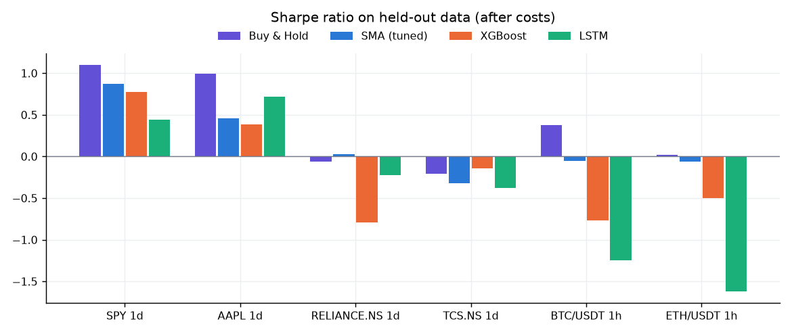
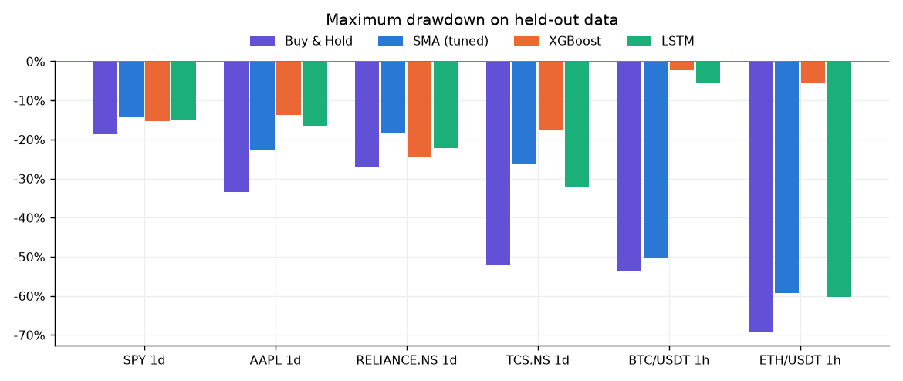
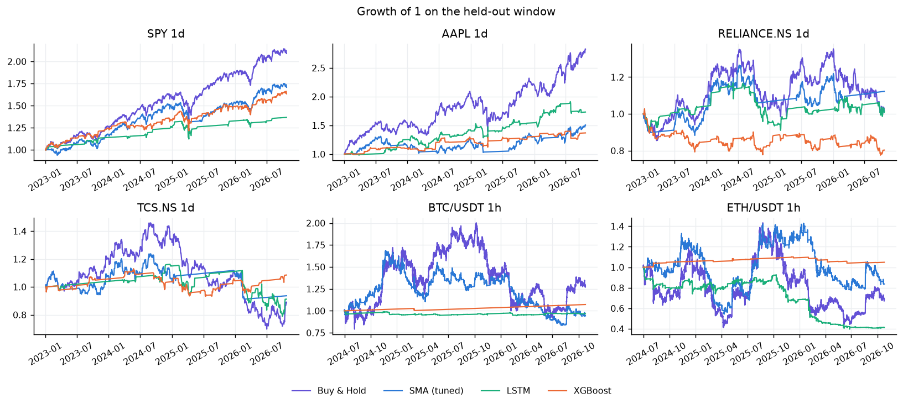
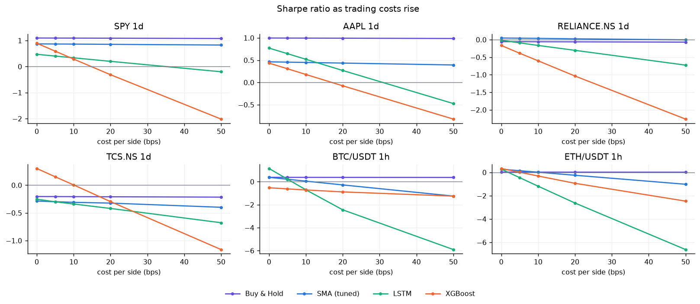
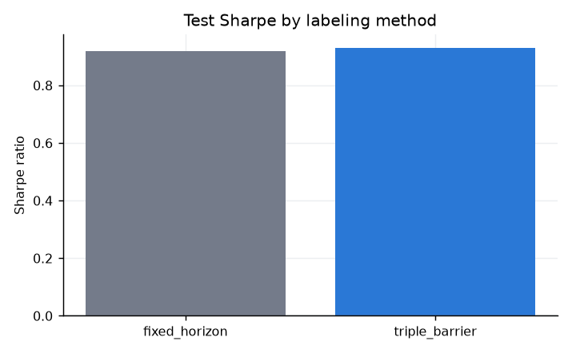
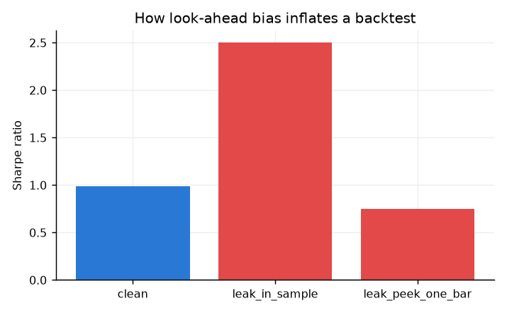
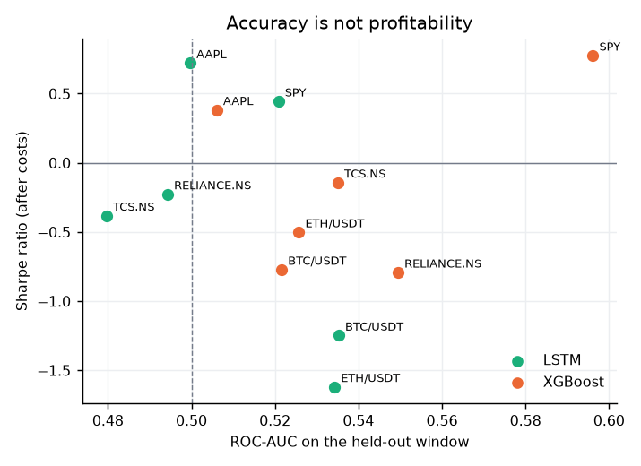
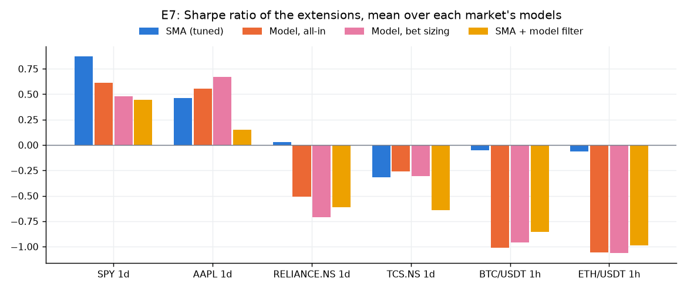

# Experiment results

Generated 2026-10-25 11:05 UTC from commit `41bac79` with `python scripts/run_experiments.py --with-training` on the bundled data snapshots. Every number below is on each market's held-out window (after the models' validation period plus embargo), after the market's cost preset. Returns and drawdowns are fractions of starting equity.

## Markets and settings

| market | held-out window | bars | cost preset | tuned SMA | models | data hash |
|---|---|---|---|---|---|---|
| SPY 1d | 2023-01-01 to 2026-10-23 | 956 | us_equity | 30/200 | lstm_spy_1d_fh_v1, xgb_spy_1d_tb_v1 | sha256:fdecd494b1ce |
| AAPL 1d | 2023-01-01 to 2026-10-23 | 956 | us_equity | 50/100 | lstm_aapl_1d_fh_v1, xgb_aapl_1d_tb_v1 | sha256:e1206a2c4dac |
| RELIANCE.NS 1d | 2023-01-01 to 2026-10-23 | 940 | india_equity_nse | 50/200 | lstm_reliance.ns_1d_fh_v1, xgb_reliance.ns_1d_tb_v1 | sha256:cffe7dfd7ab9 |
| TCS.NS 1d | 2023-01-01 to 2026-10-23 | 940 | india_equity_nse | 30/150 | lstm_tcs.ns_1d_fh_v1, xgb_tcs.ns_1d_tb_v1 | sha256:e7a176db2234 |
| BTC/USDT 1h | 2024-07-01 to 2026-10-25 | 20309 | crypto_spot | 50/100 | lstm_btc-usdt_1h_fh_v1, xgb_btc-usdt_1h_tb_v1 | sha256:1fcb152c2ea9 |
| ETH/USDT 1h | 2024-07-01 to 2026-10-25 | 20309 | crypto_spot | 30/100 | lstm_eth-usdt_1h_fh_v1, xgb_eth-usdt_1h_tb_v1 | sha256:673e8772c414 |

## E1 and E5: main comparison with Deflated Sharpe and bootstrap test

`sharpe_diff_vs_sma` is the strategy's Sharpe minus the tuned SMA's, with a 95% stationary-bootstrap confidence interval and a one-sided p-value.

| market | strategy | window | total_return | cagr | sharpe | sortino | max_drawdown | calmar | psr | dsr | trials | trades | sharpe_diff_vs_sma | ci_low | ci_high | p_value |
|---|---|---|---|---|---|---|---|---|---|---|---|---|---|---|---|---|
| SPY 1d | buy_hold | 2023-01-01 to 2026-10-23 | 107.0% | 21.1% | 1.097 | 1.630 | -18.7% | 1.129 | 98.5% | 98.5% | 1 | 1 | 0.226 | -0.078 | 0.640 | 0.128 |
| SPY 1d | sma_crossover | 2023-01-01 to 2026-10-23 | 70.8% | 15.1% | 0.871 | 1.217 | -14.3% | 1.060 | 95.2% | 68.6% | 19 | 2 | — | — | — | — |
| SPY 1d | lstm | 2023-01-01 to 2026-10-23 | 35.5% | 8.3% | 0.445 | 0.671 | -15.1% | 0.550 | 81.5% | 21.3% | 16 | 26 | -0.426 | -1.297 | 0.536 | 0.851 |
| SPY 1d | xgboost | 2023-01-01 to 2026-10-23 | 61.8% | 13.5% | 0.776 | 1.177 | -15.4% | 0.881 | 94.1% | 0.0% | 56 | 140 | -0.095 | -0.750 | 0.600 | 0.630 |
| AAPL 1d | buy_hold | 2023-01-01 to 2026-10-23 | 171.5% | 30.1% | 0.997 | 1.490 | -33.4% | 0.903 | 97.5% | 97.5% | 1 | 1 | 0.537 | -0.137 | 1.244 | 0.072 |
| AAPL 1d | sma_crossover | 2023-01-01 to 2026-10-23 | 50.7% | 11.4% | 0.460 | 0.644 | -22.7% | 0.502 | 81.3% | 42.8% | 19 | 5 | — | — | — | — |
| AAPL 1d | lstm | 2023-01-01 to 2026-10-23 | 73.3% | 15.6% | 0.721 | 1.150 | -16.7% | 0.933 | 93.1% | 0.8% | 16 | 78 | 0.261 | -0.808 | 1.356 | 0.311 |
| AAPL 1d | xgboost | 2023-01-01 to 2026-10-23 | 36.8% | 8.6% | 0.383 | 0.653 | -13.6% | 0.633 | 78.7% | 5.6% | 56 | 65 | -0.077 | -1.180 | 0.962 | 0.550 |
| RELIANCE.NS 1d | buy_hold | 2023-01-01 to 2026-10-23 | 2.4% | 0.6% | -0.060 | -0.087 | -27.1% | 0.024 | 45.4% | 45.4% | 1 | 1 | -0.090 | -0.757 | 0.608 | 0.602 |
| RELIANCE.NS 1d | sma_crossover | 2023-01-01 to 2026-10-23 | 13.2% | 3.4% | 0.030 | 0.043 | -18.5% | 0.183 | 52.3% | 11.9% | 19 | 3 | — | — | — | — |
| RELIANCE.NS 1d | lstm | 2023-01-01 to 2026-10-23 | 1.1% | 0.3% | -0.226 | -0.322 | -22.1% | 0.014 | 33.1% | 0.0% | 16 | 34 | -0.256 | -1.285 | 0.814 | 0.687 |
| RELIANCE.NS 1d | xgboost | 2023-01-01 to 2026-10-23 | -19.7% | -5.7% | -0.792 | -1.082 | -24.6% | -0.233 | 6.5% | 0.2% | 56 | 95 | -0.822 | -1.780 | 0.126 | 0.955 |
| TCS.NS 1d | buy_hold | 2023-01-01 to 2026-10-23 | -11.2% | -3.1% | -0.208 | -0.301 | -52.3% | -0.060 | 34.4% | 34.4% | 1 | 1 | 0.112 | -0.799 | 1.014 | 0.395 |
| TCS.NS 1d | sma_crossover | 2023-01-01 to 2026-10-23 | -6.5% | -1.8% | -0.320 | -0.447 | -26.3% | -0.068 | 26.8% | 2.2% | 19 | 6 | — | — | — | — |
| TCS.NS 1d | lstm | 2023-01-01 to 2026-10-23 | -8.8% | -2.4% | -0.381 | -0.540 | -32.1% | -0.076 | 23.2% | 0.0% | 16 | 23 | -0.061 | -1.387 | 1.200 | 0.547 |
| TCS.NS 1d | xgboost | 2023-01-01 to 2026-10-23 | 8.5% | 2.2% | -0.142 | -0.194 | -17.5% | 0.127 | 39.1% | 0.7% | 56 | 54 | 0.178 | -0.961 | 1.309 | 0.393 |
| BTC/USDT 1h | buy_hold | 2024-07-01 to 2026-10-25 | 28.6% | 11.5% | 0.378 | 0.534 | -53.7% | 0.213 | 71.8% | 71.8% | 1 | 1 | 0.428 | -0.570 | 1.473 | 0.210 |
| BTC/USDT 1h | sma_crossover | 2024-07-01 to 2026-10-25 | -5.6% | -2.5% | -0.050 | -0.071 | -50.5% | -0.049 | 47.0% | 1.2% | 19 | 120 | — | — | — | — |
| BTC/USDT 1h | lstm | 2024-07-01 to 2026-10-25 | -3.2% | -1.4% | -1.247 | -1.583 | -5.6% | -0.253 | 2.2% | 0.0% | 16 | 91 | -1.198 | -2.734 | 0.441 | 0.934 |
| BTC/USDT 1h | xgboost | 2024-07-01 to 2026-10-25 | 7.2% | 3.0% | -0.771 | -0.831 | -2.3% | 1.314 | 5.2% | 0.0% | 31 | 3 | -0.722 | -2.157 | 1.070 | 0.858 |
| ETH/USDT 1h | buy_hold | 2024-07-01 to 2026-10-25 | -31.3% | -14.9% | 0.022 | 0.030 | -69.1% | -0.216 | 51.3% | 51.3% | 1 | 1 | 0.086 | -1.023 | 1.236 | 0.456 |
| ETH/USDT 1h | sma_crossover | 2024-07-01 to 2026-10-25 | -16.3% | -7.4% | -0.064 | -0.092 | -59.2% | -0.125 | 46.1% | 5.5% | 19 | 128 | — | — | — | — |
| ETH/USDT 1h | lstm | 2024-07-01 to 2026-10-25 | -58.9% | -31.8% | -1.619 | -2.054 | -60.4% | -0.528 | 0.5% | 0.0% | 16 | 412 | -1.554 | -3.226 | 0.238 | 0.965 |
| ETH/USDT 1h | xgboost | 2024-07-01 to 2026-10-25 | 4.9% | 2.1% | -0.501 | -0.854 | -5.6% | 0.368 | 24.7% | 0.0% | 31 | 28 | -0.437 | -2.476 | 1.322 | 0.630 |

## Verdicts

**SPY 1d.** On the window 2023-01-03 to 2026-10-23, the highest Sharpe ratio was buy_hold (1.10, max drawdown -18.7%). xgboost vs sma_crossover: Sharpe 0.78 vs 0.87, difference -0.09 (95% CI [-0.75, +0.60], p = 0.63): not statistically significant. lstm vs sma_crossover: Sharpe 0.44 vs 0.87, difference -0.43 (95% CI [-1.30, +0.54], p = 0.85): not statistically significant.

**AAPL 1d.** On the window 2023-01-03 to 2026-10-23, the highest Sharpe ratio was buy_hold (1.00, max drawdown -33.4%). lstm vs sma_crossover: Sharpe 0.72 vs 0.46, difference +0.26 (95% CI [-0.81, +1.36], p = 0.31): not statistically significant. xgboost vs sma_crossover: Sharpe 0.38 vs 0.46, difference -0.08 (95% CI [-1.18, +0.96], p = 0.55): not statistically significant.

**RELIANCE.NS 1d.** On the window 2023-01-02 to 2026-10-23, the highest Sharpe ratio was sma_crossover (0.03, max drawdown -18.5%). lstm vs sma_crossover: Sharpe -0.23 vs 0.03, difference -0.26 (95% CI [-1.28, +0.81], p = 0.69): not statistically significant. xgboost vs sma_crossover: Sharpe -0.79 vs 0.03, difference -0.82 (95% CI [-1.78, +0.13], p = 0.95): not statistically significant. After correcting for 19 trials, the Deflated Sharpe probability for sma_crossover is 0.12. Buy & Hold reference Sharpe: -0.06.

**TCS.NS 1d.** On the window 2023-01-02 to 2026-10-23, the highest Sharpe ratio was xgboost (-0.14, max drawdown -17.5%). xgboost vs sma_crossover: Sharpe -0.14 vs -0.32, difference +0.18 (95% CI [-0.96, +1.31], p = 0.39): not statistically significant. lstm vs sma_crossover: Sharpe -0.38 vs -0.32, difference -0.06 (95% CI [-1.39, +1.20], p = 0.55): not statistically significant. After correcting for 56 trials, the Deflated Sharpe probability for xgboost is 0.01. Buy & Hold reference Sharpe: -0.21.

**BTC/USDT 1h.** On the window 2024-07-01 to 2026-10-25, the highest Sharpe ratio was buy_hold (0.38, max drawdown -53.7%). xgboost vs sma_crossover: Sharpe -0.77 vs -0.05, difference -0.72 (95% CI [-2.16, +1.07], p = 0.86): not statistically significant. lstm vs sma_crossover: Sharpe -1.25 vs -0.05, difference -1.20 (95% CI [-2.73, +0.44], p = 0.93): not statistically significant.

**ETH/USDT 1h.** On the window 2024-07-01 to 2026-10-25, the highest Sharpe ratio was buy_hold (0.02, max drawdown -69.1%). xgboost vs sma_crossover: Sharpe -0.50 vs -0.06, difference -0.44 (95% CI [-2.48, +1.32], p = 0.63): not statistically significant. lstm vs sma_crossover: Sharpe -1.62 vs -0.06, difference -1.55 (95% CI [-3.23, +0.24], p = 0.97): not statistically significant.

## E2: cost sensitivity

Sharpe ratio at 0, 5, 10, 20 and 50 bps per side (commission and slippage combined). `break_even_bps` is the cost per side at which the strategy's total return falls to zero: — means it stays positive up to 50 bps, 0 means it is negative even without costs.

| market | strategy | break_even_bps |
|---|---|---|
| SPY 1d | buy_hold | — |
| SPY 1d | sma_crossover | — |
| SPY 1d | lstm | — |
| SPY 1d | xgboost | 19 |
| AAPL 1d | buy_hold | — |
| AAPL 1d | sma_crossover | — |
| AAPL 1d | lstm | 39 |
| AAPL 1d | xgboost | 27 |
| RELIANCE.NS 1d | buy_hold | — |
| RELIANCE.NS 1d | sma_crossover | — |
| RELIANCE.NS 1d | lstm | 16 |
| RELIANCE.NS 1d | xgboost | 2.817 |
| TCS.NS 1d | buy_hold | 0.000 |
| TCS.NS 1d | sma_crossover | 0.000 |
| TCS.NS 1d | lstm | 0.000 |
| TCS.NS 1d | xgboost | 23 |
| BTC/USDT 1h | buy_hold | — |
| BTC/USDT 1h | sma_crossover | 11 |
| BTC/USDT 1h | lstm | 11 |
| BTC/USDT 1h | xgboost | — |
| ETH/USDT 1h | buy_hold | 0.000 |
| ETH/USDT 1h | sma_crossover | 6.095 |
| ETH/USDT 1h | lstm | 2.468 |
| ETH/USDT 1h | xgboost | 22 |

## E3: labeling ablation (SPY)

XGBoost trained with each labeling method, scored on the test window.

| label_method | val_auc | test_sharpe | test_total_return | test_max_drawdown | test_trades |
|---|---|---|---|---|---|
| fixed_horizon | 0.463 | 0.918 | 81.6% | -17.1% | 79 |
| triple_barrier | 0.559 | 0.930 | 55.0% | -9.3% | 106 |

## E4: look-ahead bias (SPY)

The same model evaluated cleanly, after training on the test window, and when trading one bar early.

| variant | sharpe | total_return | max_drawdown |
|---|---|---|---|
| clean | 0.988 | 93.9% | -18.8% |
| leak_in_sample | 2.501 | 284.0% | -10.3% |
| leak_peek_one_bar | 0.747 | 68.8% | -18.8% |

## E6: accuracy vs profitability

Classification quality on the held-out window next to the trading result.

| market | model | accuracy | roc_auc | base_rate | sharpe | total_return |
|---|---|---|---|---|---|---|
| SPY 1d | lstm | 51.2% | 0.521 | 56.0% | 0.445 | 35.5% |
| SPY 1d | xgboost | 57.6% | 0.596 | 38.1% | 0.776 | 61.8% |
| AAPL 1d | lstm | 50.3% | 0.500 | 54.7% | 0.721 | 73.3% |
| AAPL 1d | xgboost | 51.7% | 0.506 | 39.4% | 0.383 | 36.8% |
| RELIANCE.NS 1d | lstm | 49.1% | 0.494 | 50.1% | -0.226 | 1.1% |
| RELIANCE.NS 1d | xgboost | 50.7% | 0.549 | 30.5% | -0.792 | -19.7% |
| TCS.NS 1d | lstm | 50.2% | 0.480 | 47.2% | -0.381 | -8.8% |
| TCS.NS 1d | xgboost | 47.4% | 0.535 | 28.6% | -0.142 | 8.5% |
| BTC/USDT 1h | lstm | 52.5% | 0.535 | 50.8% | -1.247 | -3.2% |
| BTC/USDT 1h | xgboost | 51.2% | 0.522 | 42.5% | -0.771 | 7.2% |
| ETH/USDT 1h | lstm | 52.6% | 0.534 | 50.8% | -1.619 | -58.9% |
| ETH/USDT 1h | xgboost | 52.2% | 0.526 | 42.7% | -0.501 | 4.9% |

## E7: ML filter and bet sizing

Each model as a confirmation filter on the tuned SMA, and with probability bet sizing (AFML Ch. 10), on the same window and costs. Idle cash earns the risk-free rate, so holding smaller positions is not penalised in the Sharpe ratio.

| market | variant | label | total_return | sharpe | max_drawdown | exposure | trades | total_costs |
|---|---|---|---|---|---|---|---|---|
| SPY 1d | sma_crossover | SMA (tuned) | 70.8% | 0.871 | -14.3% | 93.2% | 2 | 107 |
| SPY 1d | lstm_all_in | LSTM (all-in) | 35.5% | 0.445 | -15.1% | 16.8% | 26 | 1,233 |
| SPY 1d | lstm_sized | LSTM (bet sizing) | 18.2% | 0.438 | -1.1% | 16.8% | 26 | 110 |
| SPY 1d | sma_lstm_filter | SMA + LSTM filter | 25.1% | 0.303 | -10.5% | 14.6% | 23 | 1,060 |
| SPY 1d | xgboost_all_in | XGBoost (all-in) | 61.8% | 0.776 | -15.4% | 45.2% | 140 | 7,393 |
| SPY 1d | xgboost_sized | XGBoost (bet sizing) | 20.0% | 0.524 | -1.6% | 45.2% | 140 | 947 |
| SPY 1d | sma_xgboost_filter | SMA + XGBoost filter | 42.7% | 0.585 | -10.7% | 43.0% | 131 | 6,362 |
| AAPL 1d | sma_crossover | SMA (tuned) | 50.7% | 0.460 | -22.7% | 66.2% | 5 | 231 |
| AAPL 1d | lstm_all_in | LSTM (all-in) | 73.3% | 0.721 | -16.7% | 36.2% | 78 | 4,332 |
| AAPL 1d | lstm_sized | LSTM (bet sizing) | 22.7% | 0.814 | -1.3% | 36.2% | 78 | 372 |
| AAPL 1d | sma_lstm_filter | SMA + LSTM filter | 21.5% | 0.158 | -16.0% | 21.4% | 45 | 2,044 |
| AAPL 1d | xgboost_all_in | XGBoost (all-in) | 36.8% | 0.383 | -13.6% | 14.1% | 65 | 3,135 |
| AAPL 1d | xgboost_sized | XGBoost (bet sizing) | 24.4% | 0.530 | -2.4% | 14.1% | 65 | 652 |
| AAPL 1d | sma_xgboost_filter | SMA + XGBoost filter | 20.3% | 0.145 | -12.9% | 11.0% | 44 | 1,964 |
| RELIANCE.NS 1d | sma_crossover | SMA (tuned) | 13.2% | 0.030 | -18.5% | 57.9% | 3 | 876 |
| RELIANCE.NS 1d | lstm_all_in | LSTM (all-in) | 1.1% | -0.226 | -22.1% | 33.8% | 34 | 10,117 |
| RELIANCE.NS 1d | lstm_sized | LSTM (bet sizing) | 14.5% | -0.304 | -0.9% | 33.8% | 34 | 1,055 |
| RELIANCE.NS 1d | sma_lstm_filter | SMA + LSTM filter | 7.0% | -0.218 | -12.4% | 16.0% | 21 | 6,003 |
| RELIANCE.NS 1d | xgboost_all_in | XGBoost (all-in) | -19.7% | -0.792 | -24.6% | 36.3% | 95 | 23,396 |
| RELIANCE.NS 1d | xgboost_sized | XGBoost (bet sizing) | 2.5% | -1.113 | -3.7% | 36.3% | 95 | 8,076 |
| RELIANCE.NS 1d | sma_xgboost_filter | SMA + XGBoost filter | -19.5% | -1.005 | -25.7% | 25.0% | 50 | 12,299 |
| TCS.NS 1d | sma_crossover | SMA (tuned) | -6.5% | -0.320 | -26.3% | 50.5% | 6 | 1,807 |
| TCS.NS 1d | lstm_all_in | LSTM (all-in) | -8.8% | -0.381 | -32.1% | 27.1% | 23 | 6,803 |
| TCS.NS 1d | lstm_sized | LSTM (bet sizing) | 13.2% | -0.396 | -2.3% | 27.1% | 23 | 1,108 |
| TCS.NS 1d | sma_lstm_filter | SMA + LSTM filter | 3.5% | -0.565 | -10.6% | 7.8% | 11 | 3,256 |
| TCS.NS 1d | xgboost_all_in | XGBoost (all-in) | 8.5% | -0.142 | -17.5% | 18.3% | 54 | 15,769 |
| TCS.NS 1d | xgboost_sized | XGBoost (bet sizing) | 13.8% | -0.220 | -2.4% | 18.3% | 54 | 4,263 |
| TCS.NS 1d | sma_xgboost_filter | SMA + XGBoost filter | -2.4% | -0.717 | -14.4% | 7.7% | 22 | 6,423 |
| BTC/USDT 1h | sma_crossover | SMA (tuned) | -5.6% | -0.050 | -50.5% | 53.1% | 120 | 37,712 |
| BTC/USDT 1h | lstm_all_in | LSTM (all-in) | -3.2% | -1.247 | -5.6% | 0.9% | 91 | 22,803 |
| BTC/USDT 1h | lstm_sized | LSTM (bet sizing) | 6.1% | -1.150 | -1.1% | 0.9% | 91 | 6,970 |
| BTC/USDT 1h | sma_lstm_filter | SMA + LSTM filter | 3.5% | -0.941 | -3.5% | 0.5% | 54 | 14,284 |
| BTC/USDT 1h | xgboost_all_in | XGBoost (all-in) | 7.2% | -0.771 | -2.3% | 0.0% | 3 | 791 |
| BTC/USDT 1h | xgboost_sized | XGBoost (bet sizing) | 9.0% | -0.768 | -0.7% | 0.0% | 3 | 239 |
| BTC/USDT 1h | sma_xgboost_filter | SMA + XGBoost filter | 7.2% | -0.771 | -2.3% | 0.0% | 3 | 791 |
| ETH/USDT 1h | sma_crossover | SMA (tuned) | -16.3% | -0.064 | -59.2% | 50.9% | 128 | 32,461 |
| ETH/USDT 1h | lstm_all_in | LSTM (all-in) | -58.9% | -1.619 | -60.4% | 7.8% | 412 | 77,144 |
| ETH/USDT 1h | lstm_sized | LSTM (bet sizing) | -6.0% | -1.481 | -11.1% | 7.8% | 412 | 18,122 |
| ETH/USDT 1h | sma_lstm_filter | SMA + LSTM filter | -13.8% | -0.880 | -29.8% | 2.7% | 173 | 47,087 |
| ETH/USDT 1h | xgboost_all_in | XGBoost (all-in) | 4.9% | -0.501 | -5.6% | 0.2% | 28 | 7,770 |
| ETH/USDT 1h | xgboost_sized | XGBoost (bet sizing) | 9.0% | -0.643 | -0.3% | 0.2% | 28 | 955 |
| ETH/USDT 1h | sma_xgboost_filter | SMA + XGBoost filter | 2.3% | -1.100 | -4.3% | 0.2% | 22 | 5,906 |

